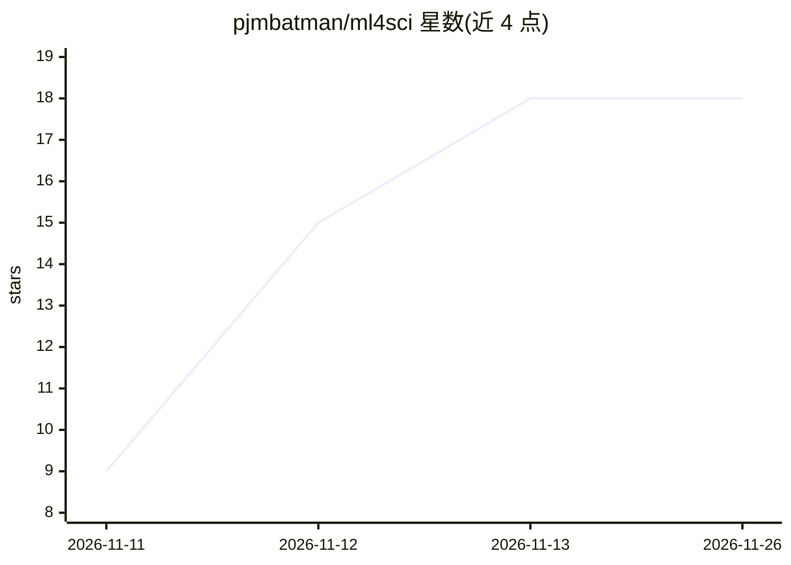

# pjmbatman/ml4sci

⭐ 18 · NOASSERTION · 推送 2026-11-20 · [GitHub](https://github.com/pjmbatman/ml4sci) · [官网](https://ml4sci.com) · 个人维护

**面向科研人员的机器学习入门交互式教材（226章，浏览器运行）**

在 ml4sci.com 提供的免费交互式数字图书，面向想在研究中引入机器学习的科学家、工程师、AI 研究者及研究生。内容为 226 章、1,406 道测验题、268 道自动评分练习，按 7 层 12 轨道组织（从基础设施、数学基础到科学机器学习与顶点项目）。浏览器内通过 Pyodide 运行 Python，PyTorch/GPU 示例以只读形式展示并附带可下载实验文件。无需注册，进度仅存于浏览器本地；英文与韩文双语。源代码与手稿不公开，内容保留所有权利，禁止再分发。

## 筛选速览

| 维度 | 判定 | 备注 |
|---|---|---|
| AI 角色 | `ai-knowledge` | 知识聚合/清单类 |
| 许可风险 | `none` | NOASSERTION |
| 部署形态 | `desktop` | 安装包/桌面程序 |
| 模型依赖 | — | README 未给出锁定关系 |
| 硬件要求 | — | 无带数字的原话,不猜 |
| 安装摩擦 | `low` | 无编译、无系统依赖或容器化 |
| 成熟度 | — | 结构信号不足 |

## 能力要点

- 226 章按 7 层 12 轨道组织，含学习路线图与学习桌面（7 个窗口应用）
- 浏览器内 Pyodide 运行 Python（NumPy/SciPy/pandas/matplotlib/scikit-learn）并自动评分 268 道练习
- 1,406 道测验题，错题解释误区并进入复习队列
- 英文与韩文双语，无需账号，进度仅存本地浏览器

## 适用场景

- 作为科研人员系统学习将机器学习引入研究的方法
- AI 研究者转向科学问题前补齐领域与研究方法基础
- 课程或学习小组共享章节链接组织学习

## 场景标签

`教程课程` · 领域:学习与行业

## 证据(README 行号)

> L27: **Machine Learning for Science** (ml4sci.com) is an interactive digital book for **scientists and engineers** who w
> L44: |**3&nbsp;·&nbsp;Code**|Write Python in a built-in editor, press *Grade* and see each test pass or fail.|268 exerci
> L53: |🧭 **A roadmap, not a pile of chapters**|226 chapters in 33 parts and 12 tracks, arranged in 7 layers. Each chapter

## 星数曲线

2026-11-11 9 → 2026-11-26 18（+9）

---
*卡片 v1 · prompt 1.4 · 生成 2026-11-18 · 置信度 high · 依据 README sha `3d290dfea134` · [字段定义](../../DATASET.md)*
