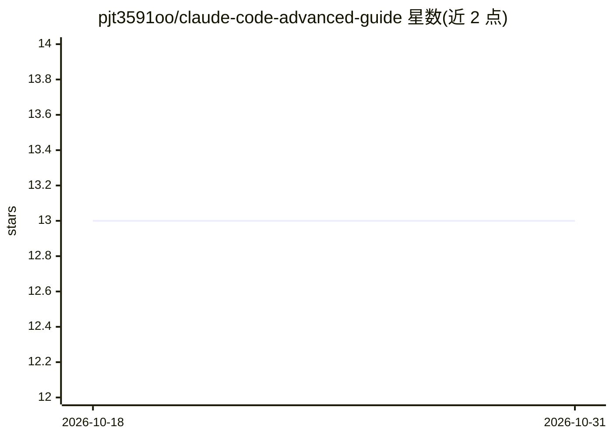

# pjt3591oo/claude-code-advanced-guide

⭐ 13 · JavaScript · 推送 2026-10-14 · [GitHub](https://github.com/pjt3591oo/claude-code-advanced-guide) · 个人维护

**Claude Code 扩展机制讲解与设计技能插件（韩文指南）**

面向开发者与 DevOps 工程师的韩文教程仓库：讲解 Claude Code 的 .claude 配置体系，覆盖 slash commands、hooks、sub agents、skills、plugins 五类扩展的定义方式、目录结构与调用机制，并对比 skill 与 slash command 的差异（复杂度、文件结构、调用方式）。同时随仓库提供一个设计系统技能插件（design-sense-plugin），可通过 /plugin marketplace 或 npx skills add 安装到 claude-code、opencode、codex 等环境。内容要求 Claude Code 2.x 及以上版本。

## 筛选速览

| 维度 | 判定 | 备注 |
|---|---|---|
| AI 角色 | `ai-knowledge` | 知识聚合/清单类 |
| 许可风险 | `none` | — |
| 部署形态 | `library` | 以包/库形式分发 |
| 模型依赖 | — | README 未给出锁定关系 |
| 硬件要求 | — | 无带数字的原话,不猜 |
| 安装摩擦 | `low` | 无编译、无系统依赖或容器化 |
| 成熟度 | — | 结构信号不足 |

## 能力要点

- 覆盖 commands/hooks/sub agents/skills/plugins 五类扩展的配置方法
- 随附 design-sense-plugin 设计技能插件，支持 marketplace 与 npx skills 安装
- 以表格对比 slash command 与 skill 在复杂度、结构、调用方式上的差异

## 适用场景

- 学习如何为 Claude Code 编写自定义命令、钩子与子代理
- 安装设计系统技能插件辅助设计工作
- 了解插件目录结构与 marketplace 分发方式

## 场景标签

`教程课程` · 领域:学习与行业

## 证据(README 行号)

> L5: 클로드 코드는 agent, skill, hook, command 등을 통해 보다 확장성 있는 LLM 워크플로우를 구축할 수 있도록 도와줍니다.
> L7: 해당 레포는 클로드 코드의 .claude 구성을 설명하고 있으며, 디자인에 도움되는 스킬을 제공하고 있습니다.
> L29: 주로 다루는 내용은 다음과 같습니다.

## 星数曲线

2026-10-18 13 → 2026-10-31 13（+0）

---
*卡片 v1 · prompt 1.4 · 生成 2026-10-31 · 置信度 high · 依据 README sha `2697a8079dee` · [字段定义](../../DATASET.md)*
