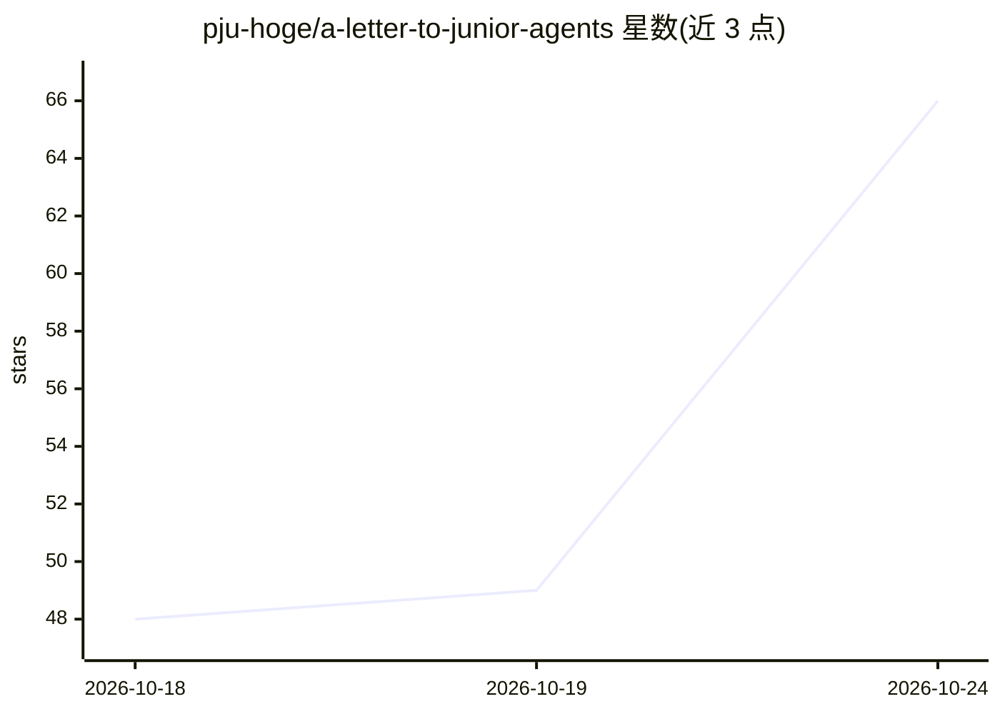

# pju-hoge/a-letter-to-junior-agents

⭐ 66 · MIT · 推送 2026-10-10 · [GitHub](https://github.com/pju-hoge/a-letter-to-junior-agents) · 个人维护

**给 Hermes 个人 agent 用的长期记忆/人设/共享工作区引导文档包**

面向 Hermes Agent 用户的引导文档与技能套件，非产品或框架：包含 SOUL.md 人设定义（跨模型更换保持角色）、AGENTS.md 常驻行为规则、hindsight 长期记忆配置、Obsidian 共享知识库、X 付费 OAuth 搜索及推荐技能清单。文档写给 agent 阅读而非人类，要求用户先自行安装配置 Hermes 再将本目录交给 agent 读取，占位符需按自身环境改写。源自约 6 个月日常运营经验的整理。

## 筛选速览

| 维度 | 判定 | 备注 |
|---|---|---|
| AI 角色 | `ai-knowledge` | 知识聚合/清单类 |
| 许可风险 | `permissive` | MIT |
| 部署形态 | `None` |  |
| 模型依赖 | — | README 未给出锁定关系 |
| 硬件要求 | — | 无带数字的原话,不猜 |
| 安装摩擦 | `low` | 无编译、无系统依赖或容器化 |
| 成熟度 | — | 结构信号不足 |

## 能力要点

- SOUL.md 人设定义，目标跨模型更换保持角色稳定
- hindsight 长期记忆：夜间保留与整合
- agent 可读写的 Obsidian 共享工作区
- 写给 agent 阅读的规则与经验文档（含给初级 agent 的信）

## 适用场景

- 给 Hermes agent 搭建长期记忆与共享工作区
- 让个人 agent 在更换模型后保持人设一致
- 参考别人运营个人 agent 的实践与规则模板

## 场景标签

`Agent 记忆` · 领域:Agent 开发

## 证据(README 行号)

> L9: **1. This repo does not set up Hermes.** Install and configure Hermes Agent first, from the official docs: <https://
> L15: **Is:** a set of documents and skills you drop into your own Hermes profile, so your agent starts from a considered
> L17: **Isn't:** a product, a framework, or a replacement for the official docs. Read those too.

## 星数曲线

2026-10-18 48 → 2026-10-24 66（+18）

---
*卡片 v1 · prompt 1.4 · 生成 2026-10-24 · 置信度 mid · 依据 README sha `24e0da0a537b` · [字段定义](../../DATASET.md)*
