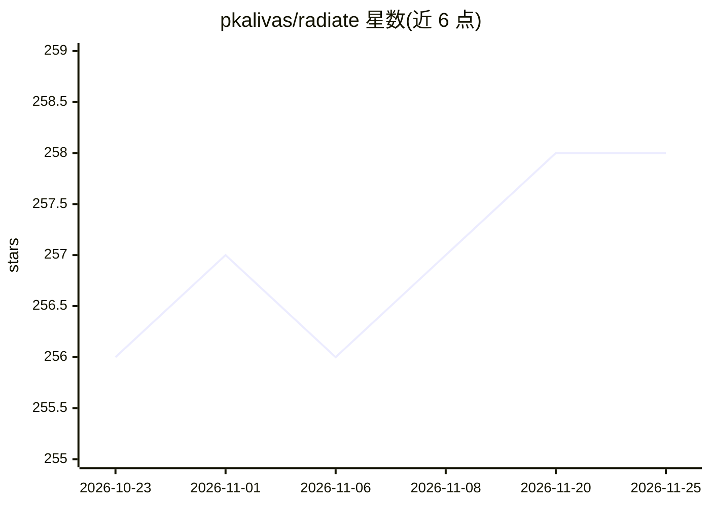

# pkalivas/radiate

⭐ 258 · Rust · MIT · 推送 2026-11-23 · [GitHub](https://github.com/pkalivas/radiate) · [官网](https://radiate.rs) · 个人维护

**Rust/Python 进化算法与遗传编程引擎**

核心以 Rust 编写、提供 Python 绑定的进化计算库，用于实现遗传算法与遗传编程技术。支持传统遗传算法、单目标与多目标优化、图表示的神经进化（可选 NEAT 实现）、树表示的遗传编程，内置并行支持、选择/交叉/变异算子、物种形成、新颖性搜索与指标跟踪。同一 Pipeline 可从字符串匹配演进到神经网络拓扑搜索与符号回归树。Rust 通过 Cargo.toml 引入，Python 经 pip/uv 安装，可从源码构建。

## 筛选速览

| 维度 | 判定 | 备注 |
|---|---|---|
| AI 角色 | `ai-native` | 本体是模型或模型工具 |
| 许可风险 | `permissive` | MIT |
| 部署形态 | `library` | 以包/库形式分发 |
| 模型依赖 | — | README 未给出锁定关系 |
| 硬件要求 | — | 无带数字的原话,不猜 |
| 安装摩擦 | `low` | 无编译、无系统依赖或容器化 |
| 成熟度 | — | 结构信号不足 |

## 能力要点

- 单目标与多目标优化支持
- 图表示神经进化，可选 NEAT 实现；树表示遗传编程
- 内置并行与选择/交叉/变异算子集合
- 指标跟踪与动态表达式 DSL

## 适用场景

- 用遗传算法求解字符串匹配等优化问题
- 做 NEAT 风格神经网络拓扑进化实验
- 符号回归树的遗传编程实现
- 多目标优化问题建模

## 场景标签

 · 领域:算法/进化计算

## 证据(README 行号)

> L13: Radiate is a powerful library for implementing genetic algorithms and artificial evolution techniques. It provides 
> L18: * Neuroevolution (graph-based representation - evolving neural networks) support. Opt-in NEAT implementation.

## 星数曲线

2026-10-23 256 → 2026-11-25 258（+2）

---
*卡片 v1 · prompt 1.4 · 生成 2026-11-25 · 置信度 high · 依据 README sha `d609737ae034` · [字段定义](../../DATASET.md)*
