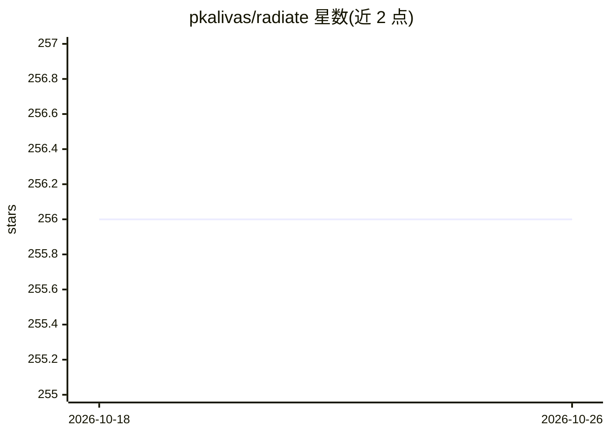

# pkalivas/radiate

⭐ 256 · Rust · MIT · 推送 2026-10-24 · [GitHub](https://github.com/pkalivas/radiate) · [官网](https://radiate.rs) · 个人维护

**面向开发者的遗传算法与神经进化引擎（Rust 核心 + Python 绑定）**

用 Rust 编写并提供 Python 绑定的进化计算库，支持传统遗传算法、单/多目标优化、图表示的神经进化（含 opt-in NEAT）、树表示的遗传编程、并行化、新颖性搜索与指标跟踪；提供动态表达式 DSL 用于动态速率与自定义指标。同一 Pipeline 可从字符串匹配进化到 NEAT 神经网络与符号回归树。通过 Cargo 或 pip 安装，源码构建使用 Just 构建工具。

## 筛选速览

| 维度 | 判定 | 备注 |
|---|---|---|
| AI 角色 | `ai-native` | 本体是模型或模型工具 |
| 许可风险 | `permissive` | MIT |
| 部署形态 | `library` | 以包/库形式分发 |
| 模型依赖 | — | README 未给出锁定关系 |
| 硬件要求 | — | 无带数字的原话,不猜 |
| 安装摩擦 | `low` | 无编译、无系统依赖或容器化 |
| 成熟度 | — | 结构信号不足 |

## 能力要点

- 单/多目标优化与图式神经进化（opt-in NEAT）
- 遗传编程（树表示）与新颖性搜索支持
- 内置并行与第一方指标跟踪
- 动态表达式 DSL 用于动态速率与自定义指标

## 适用场景

- 用遗传算法求解优化问题
- 进化神经网络拓扑（NEAT 风格）
- 做符号回归与遗传编程实验

## 场景标签

 · 领域:进化计算/机器学习库

## 证据(README 行号)

> L13: Radiate is a powerful library for implementing genetic algorithms and artificial evolution techniques. It provides 
> L18: * Neuroevolution (graph-based representation - evolving neural networks) support. Opt-in NEAT implementation.

## 星数曲线

2026-10-18 256 → 2026-10-26 256（+0）

---
*卡片 v1 · prompt 1.4 · 生成 2026-10-22 · 置信度 high · 依据 README sha `f7a9a164ea6d` · [字段定义](../../DATASET.md)*
