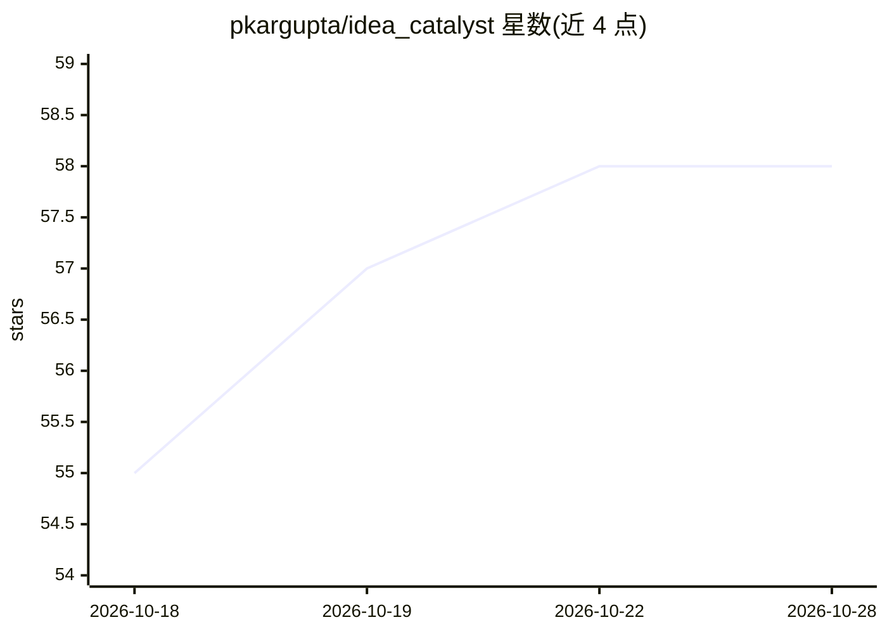

# pkargupta/idea_catalyst

⭐ 58 · Python · 推送 2026-03-15 · [GitHub](https://github.com/pkargupta/idea_catalyst) · [官网](https://pkargupta.github.io/idea_catalyst.html) · 个人维护

**科研脑暴框架：跨域文献检索生成可迁移研究灵感**

面向科研人员的 LLM 驱动科研创意框架：将研究问题分解为子问题，经 Semantic Scholar API 检索目标域与跨域文献，整合并排序可迁移的跨域灵感，输出按问题/领域分组的证据与 idea_rankings。默认使用 data/cross-domain-inspiration-relations.json 数据集（源自 CHIMERA），支持指定模型（示例为 Qwen3-14B）与输出目录，另提供从 arXiv 摘要生成评测输入的脚本。需配置 Semantic Scholar API key。

## 筛选速览

| 维度 | 判定 | 备注 |
|---|---|---|
| AI 角色 | `ai-native` | 本体是模型或模型工具 |
| 许可风险 | `none` | — |
| 部署形态 | `library` | 以包/库形式分发 |
| 模型依赖 | — | README 未给出锁定关系 |
| 硬件要求 | — | 无带数字的原话,不猜 |
| 安装摩擦 | `low` | 无编译、无系统依赖或容器化 |
| 成熟度 | — | 结构信号不足 |

## 能力要点

- 研究问题自动分解为子问题
- 经 Semantic Scholar 检索目标域与跨域文献
- 整合并排序跨域可迁移灵感（idea_rankings）
- 内置源自 CHIMERA 的跨域灵感关系数据集与评测脚本

## 适用场景

- 为自己的研究问题寻找其他学科的可借鉴思路
- 从文献中生成并排序跨域研究灵感
- 基于 arXiv 摘要构建跨域灵感评测输入

## 场景标签

`科研工具` · 领域:学习与行业

## 证据(README 行号)

> L9: # Sparking Scientific Creativity via LLM-Driven Interdisciplinary Inspiration
> L13: Identify insights from other domains that help address challenges or open up novel opportunities for your research 

## 星数曲线

2026-10-18 55 → 2026-10-28 58（+3）

---
*卡片 v1 · prompt 1.4 · 生成 2026-10-24 · 置信度 high · 依据 README sha `26a5d2c94354` · [字段定义](../../DATASET.md)*
