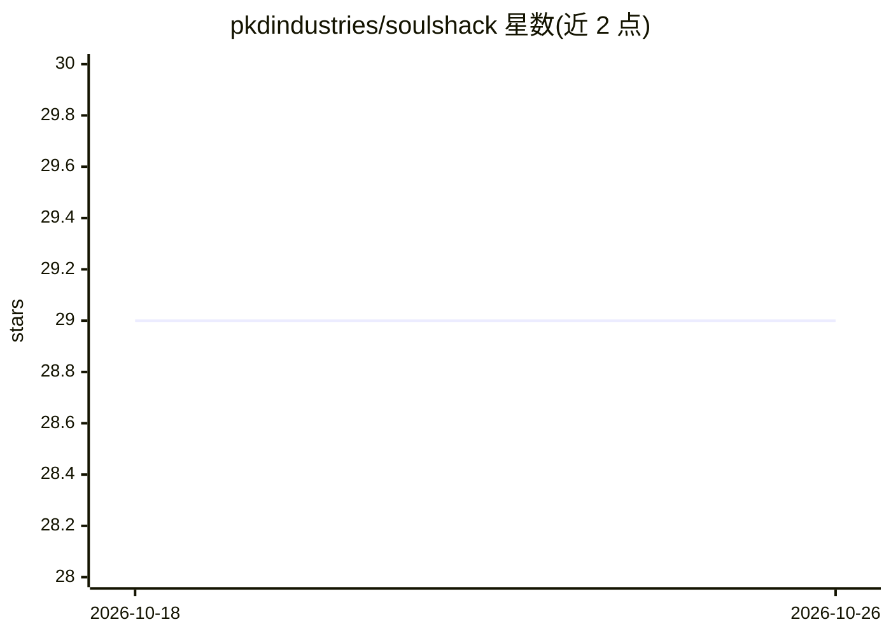

# pkdindustries/soulshack

⭐ 29 · Go · GPL-3.0 · 推送 2026-09-27 · [GitHub](https://github.com/pkdindustries/soulshack) · 个人维护

**LLM 驱动的 IRC 聊天机器人，多模型接入并带工具与沙箱**

用 Go 编写的 IRC 聊天机器人，接入 OpenAI、Anthropic、Google Gemini 与本地 Ollama 作为 LLM 后端，在 IRC 频道中提供流式回复。工具系统支持 shell 脚本、MCP 服务器与原生 IRC 管理工具（op/kick/ban/topic 等），可经 IRC 命令在运行时增删工具与调整配置。提供可选沙箱模式，限制 shell 与 MCP 工具的文件写入和网络访问，默认关闭且依赖系统后端（macOS sandbox-exec、Linux bwrap）。安装方式为 Docker 构建或 Go 1.23+ 源码编译。

## 筛选速览

| 维度 | 判定 | 备注 |
|---|---|---|
| AI 角色 | `ai-native` | 本体是模型或模型工具 |
| 许可风险 | `viral` | GPL-3.0 |
| 部署形态 | `self-host` | docker 或自建部署 |
| 模型依赖 | local-ok | 支持本地模型 |
| 硬件要求 | — | 无带数字的原话,不猜 |
| 安装摩擦 | `low` | 无编译、无系统依赖或容器化 |
| 成熟度 | — | 结构信号不足 |

## 能力要点

- 支持 OpenAI/Anthropic/Gemini/Ollama 四类 LLM 后端
- 统一工具系统：shell 脚本、MCP 服务器与原生 IRC 管理工具
- 可选沙箱：限制写路径、出站网络与敏感凭据读取，支持按工具覆盖策略
- 通过 IRC 命令运行时管理工具、管理员与配置参数

## 适用场景

- 在 IRC 频道部署一个由 LLM 驱动的聊天机器人
- 让机器人经 shell/MCP 工具执行操作并管理频道（踢人、封禁、话题等）
- 本地 Ollama 模型离线驱动 IRC 机器人

## 场景标签

 · 领域:聊天机器人/IRC 工具

## 证据(README 行号)

> L5: **Soulshack** is an advanced IRC chatbot powered by LLMs, designed to bridge traditional chat with modern AI capabil
> L9: - **Multi-Provider Support**: Works with OpenAI, Anthropic, Google Gemini, and Ollama.
> L10: - **Unified Tool System**: Supports shell scripts, MCP servers, and native IRC tools.

## 星数曲线

2026-10-18 29 → 2026-10-26 29（+0）

---
*卡片 v1 · prompt 1.4 · 生成 2026-10-26 · 置信度 high · 依据 README sha `137bcc933e2d` · [字段定义](../../DATASET.md)*
