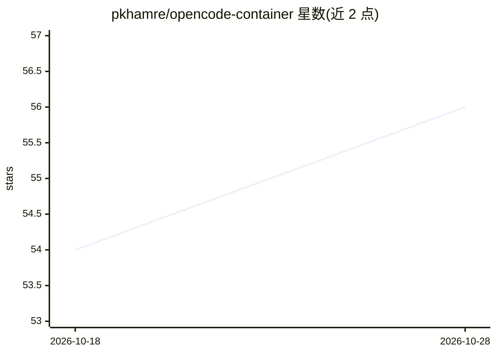

# pkhamre/opencode-container

⭐ 57 · Shell · 推送 2026-10-22 · [GitHub](https://github.com/pkhamre/opencode-container) · 个人维护

**在加固容器中隔离运行 OpenCode CLI 的封装环境**

为 OpenCode CLI（AI 编程 agent）提供 Docker/Podman 容器化运行环境：只读根文件系统、丢弃全部 Linux capabilities、阻断提权、非 root 用户、4GB 内存/4 CPU 资源限制，当前目录作为唯一可写工作区挂载。API 密钥以文件形式在启动时挂载到 /run/secrets，由 bootstrap.py 读取并注入环境变量，支持 Anthropic/OpenAI/Vertex AI/AWS Bedrock 等提供商密钥文件。镜像为多阶段构建的 distroless 运行时（Debian 13 + Node 24 + Python 3），提供 bin/opencode-container 封装脚本与 Makefile 构建命令。

## 筛选速览

| 维度 | 判定 | 备注 |
|---|---|---|
| AI 角色 | `ai-ecosystem` | LLM/agent 周边工具 |
| 许可风险 | `none` | — |
| 部署形态 | `self-host` | docker 或自建部署 |
| 模型依赖 | — | README 未给出锁定关系 |
| 硬件要求 | — | 无带数字的原话,不猜 |
| 安装摩擦 | `low` | 无编译、无系统依赖或容器化 |
| 成熟度 | — | 结构信号不足 |

## 能力要点

- 只读根文件系统 + 全部 capabilities 丢弃 + no-new-privileges 的多层隔离
- 文件式密钥管理：/run/secrets 挂载并由 bootstrap.py 加载为环境变量
- 数据持久化到 ~/.opencode-container/（会话、缓存、设置）
- distroless 多阶段构建，安装器校验和验证

## 适用场景

- 在受限沙箱中运行 AI 编程 agent，降低其操作宿主机的风险
- 管理 OpenCode 的多个提供商 API 密钥且不经命令行传递
- 在 Fedora/SELinux 环境下安全运行容器化 OpenCode

## 场景标签

`编码 Agent` · 领域:编码与开发

## 证据(README 行号)

> L3: Run the OpenCode CLI inside a locked-down container (Docker or Podman): read-only root filesystem, all Linux capabil
> L84: - **Distroless runtime:** no package manager and no compiler; a minimal POSIX shell (`/bin/sh`) is present because 
> L242: - **Bootstrap:** `bootstrap.py` loads supported secrets from `/run/secrets`, then execs OpenCode

## 星数曲线

2026-10-18 54 → 2026-10-28 56（+2）

---
*卡片 v1 · prompt 1.4 · 生成 2026-10-24 · 置信度 mid · 依据 README sha `3fc39b9dd3d9` · [字段定义](../../DATASET.md)*
