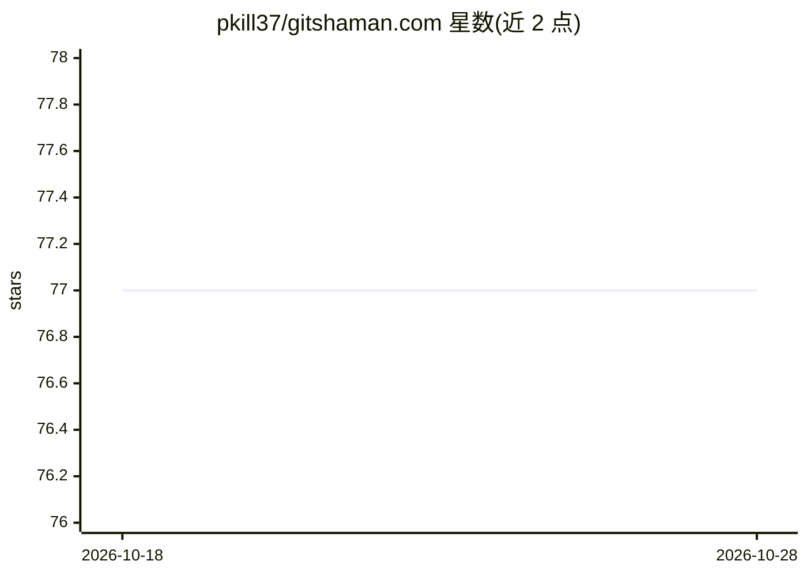

# pkill37/gitshaman.com

⭐ 77 · TypeScript · 推送 2026-10-26 · [GitHub](https://github.com/pkill37/gitshaman.com) · [官网](https://gitshaman.com) · 个人维护

**语义代码智能工具：静态源码浏览与本地代码分析 CLI**

GitShaman 是一个 static-first 的 Next.js 源码浏览器，结合 VS Code 风格工作区、索引搜索、Monaco 导航、语义图与仓库级讨论。配套 CLI 可对本地 Git 仓库执行源码分析：生成结构索引与嵌入向量，支持语义搜索（如用自然语言查询代码行为），并在本地启动浏览器工作区。默认嵌入 provider 为本机 Ollama（embeddinggemma 模型），可切换 OpenRouter；无 provider 时仍可完成结构分析。另含基于 Sphinx 的 Quiz 理解检查与向社区策展集贡献仓库的分享流程。

## 筛选速览

| 维度 | 判定 | 备注 |
|---|---|---|
| AI 角色 | `ai-enhanced` | 去掉 AI 部分产品仍成立 |
| 许可风险 | `none` | — |
| 部署形态 | `library` | 以包/库形式分发 |
| 模型依赖 | local-ok | 支持本地模型 |
| 硬件要求 | — | 无带数字的原话,不猜 |
| 安装摩擦 | `low` | 无编译、无系统依赖或容器化 |
| 成熟度 | — | 结构信号不足 |

## 能力要点

- 对本地 Git 仓库生成结构索引与嵌入向量的 CLI（analyze/embed/viz 等 11 个命令）
- 语义搜索：将源码块转为嵌入向量，支持自然语言查询代码
- 默认 Ollama 本机嵌入（embeddinggemma），可配置 OpenRouter，无 provider 时仍可结构分析
- 基于 Sphinx 的 Quiz 理解检查，支持 Anki 导出与社区策展共享

## 适用场景

- 在本地浏览器工作区浏览和语义搜索自己的 Git 仓库
- 用自然语言定位代码行为（如重试逻辑的位置）
- 通过 Quiz 与 Git 钩子做变更理解检查

## 场景标签

`语义搜索` · 领域:知识与检索

## 证据(README 行号)

> L5: GitShaman is a static-first Next.js source browser. It combines curated guides, a VS Code-like
> L68: `gitshaman embed` converts chunks of the analyzed source code into embeddings: lists of numbers
> L78: The default provider is Ollama at `http://127.0.0.1:11434`, using the `embeddinggemma` model.

## 星数曲线

2026-10-18 77 → 2026-10-28 77（+0）

---
*卡片 v1 · prompt 1.4 · 生成 2026-10-24 · 置信度 high · 依据 README sha `503d162e8ccd` · [字段定义](../../DATASET.md)*
