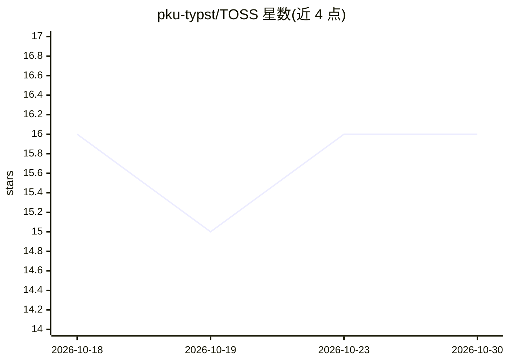

# pku-typst/TOSS

⭐ 16 · TypeScript · AGPL-3.0 · 推送 2026-09-27 · [GitHub](https://github.com/pku-typst/TOSS) · [官网](https://pku-typst.github.io/TOSS/) · 组织维护 · 中文 README

**自托管的 Typst/LaTeX 协作排版服务器，含实时编辑与 Git 集成**

面向需要自托管协作写作的平台：以 Typst 为中心，结合 CodeMirror+Yjs 实时多人编辑（在线状态、远程光标、访客会话）、浏览器内 Typst 编译与增量矢量预览，可选 BusyTeX 浏览器 LaTeX 编译与 TeX Live 后台 PDF 构建；后端为 Axum API，PostgreSQL 存储账户与协作状态，外部 Git（GitHub/GitLab/Gitea/Forgejo）仅按显式导入/同步/checkpoint 工作流访问。Docker Compose 一键源码构建启动；限制：不支持旧迁移历史的就地数据库升级，生产协调模型要求单个 Core 副本。AGPLv3 许可。

## 筛选速览

| 维度 | 判定 | 备注 |
|---|---|---|
| AI 角色 | `ai-enhanced` | 去掉 AI 部分产品仍成立 |
| 许可风险 | `viral` | AGPL-3.0 |
| 部署形态 | `self-host` | docker 或自建部署 |
| 模型依赖 | — | README 未给出锁定关系 |
| 硬件要求 | — | 无带数字的原话,不猜 |
| 安装摩擦 | `low` | 无编译、无系统依赖或容器化 |
| 成熟度 | — | 结构信号不足 |

## 能力要点

- 浏览器 worker 内 Typst 编译与双向源/预览导航
- 可选 TeX Live 后台 PDF 构建，与浏览器预览隔离不互相干扰
- 显式外部 Git 工作流：导入、分支同步、checkpoint 发布
- 全局任务中心：后台任务在发起标签页关闭后仍可见并可取消

## 适用场景

- 团队或组织自托管协作撰写 Typst/LaTeX 文档
- 在浏览器中编译预览并管理版本历史与模板库
- 将协作成果以显式 checkpoint 发布到 GitHub/GitLab 等外部仓库

## 场景标签

 · 领域:协作编辑/文档处理

## 证据(README 行号)

> L10:  - coding-agent
> L30: TOSS is a self-hosted collaborative typesetting platform centered on Typst. It

## 星数曲线

2026-10-18 16 → 2026-10-30 16（+0）

---
*卡片 v1 · prompt 1.4 · 生成 2026-10-30 · 置信度 low · 依据 README sha `f1a72a2442d8` · [字段定义](../../DATASET.md)*
