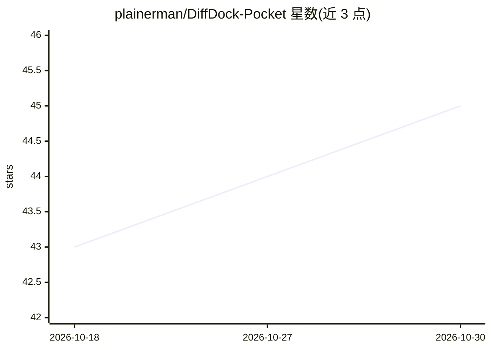

# plainerman/DiffDock-Pocket

⭐ 45 · Python · MIT · 推送 2026-10-02 · [GitHub](https://github.com/plainerman/DiffDock-Pocket) · 组织维护

**口袋级全原子分子对接扩散模型，支持侧链柔性**

DiffDock-Pocket 是在口袋（pocket）级别运行的全原子分子对接模型：对配体与侧链扭转角做扩散生成，针对计算生成的蛋白质结构（如 ESMFold）优化，并用置信度模型对采样构象排序。仓库提供训练代码、推理脚本、可视化与论文所用权重，从 DiffDock 分叉而来但两者不兼容。安装通过 conda 环境文件（CUDA 或 CPU 版本），另提供 HuggingFace 在线推理界面。训练使用 PDBBind 数据集（含预处理版本下载）。

## 筛选速览

| 维度 | 判定 | 备注 |
|---|---|---|
| AI 角色 | `ai-native` | 本体是模型或模型工具 |
| 许可风险 | `permissive` | MIT |
| 部署形态 | `None` |  |
| 模型依赖 | — | README 未给出锁定关系 |
| 硬件要求 | — | 无带数字的原话,不猜 |
| 安装摩擦 | `medium` | 含编译或系统依赖之一 |
| 成熟度 | — | 结构信号不足 |

## 能力要点

- 扩散模型生成口袋级配体构象并建模柔性侧链扭转角
- 置信度模型对采样结果排序，支持能量最小化（--relax）
- 支持指定口袋中心、柔性侧链、SMILES 输入与批量 CSV 推理
- 提供训练、推理、可视化代码与论文所用权重

## 适用场景

- 对已知口袋做带侧链柔性的配体对接预测
- 在 ESMFold 等计算生成结构上运行对接
- 在 PDBBind 上复现或训练自己的打分与置信度模型

## 场景标签

 · 领域:计算生物学/药物发现

## 证据(README 行号)

> L7: DiffDock-Pocket is an all-atom docking model operating on the pocket level. It implements diffusion over side chain 
> L8: This repository is originally a fork from DiffDock, so some of the commands may seem familiar - but it has been exte

## 星数曲线

2026-10-18 43 → 2026-10-30 45（+2）

---
*卡片 v1 · prompt 1.4 · 生成 2026-10-25 · 置信度 high · 依据 README sha `c0da4e214990` · [字段定义](../../DATASET.md)*
