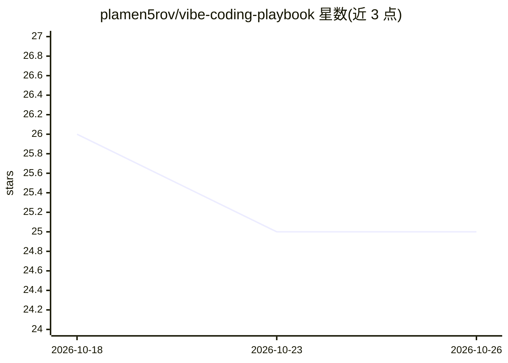

# plamen5rov/vibe-coding-playbook

⭐ 25 · Python · MIT · 推送 2026-04-05 · [GitHub](https://github.com/plamen5rov/vibe-coding-playbook) · 个人维护

**面向独立开发者的 AI 编程（vibe coding）实操手册**

一份关于使用 OpenCode 与 Claude Code 进行 AI 辅助编程的实用指南：内容源自将作者的实际问题提交给 10 个主流 LLM（ChatGPT、Claude、DeepSeek、Gemini 等），原始回答保存于 ai_answers/，经交叉比对提取共识后汇编而成。覆盖 Git 设置、上下文文件（AGENTS.md 等）、工作流、提示工程、调试、成本管理、会话管理等 13 个章节，并提供可复制的 starter-template 项目脚手架。以 Markdown 文档形式阅读使用，无安装包。

## 筛选速览

| 维度 | 判定 | 备注 |
|---|---|---|
| AI 角色 | `ai-knowledge` | 知识聚合/清单类 |
| 许可风险 | `permissive` | MIT |
| 部署形态 | `None` |  |
| 模型依赖 | — | README 未给出锁定关系 |
| 硬件要求 | — | 无带数字的原话,不猜 |
| 安装摩擦 | `low` | 无编译、无系统依赖或容器化 |
| 成熟度 | — | 结构信号不足 |

## 能力要点

- 由 10 个 LLM 对同一问题集的回答交叉综合而成，原始回答保留在 ai_answers/
- 13 个章节覆盖工作流、提示工程、调试、成本与模型选择、会话管理
- 包含可复制到新项目的 starter-template 脚手架（AGENTS.md/CHANGELOG.md 等）
- OpenCode 与 Claude Code 的并排功能对比

## 适用场景

- 独立开发者开始第一个 AI 辅助编程项目前查阅流程与检查清单
- 为 AI 编程会话准备上下文文件与项目模板
- 在 OpenCode 与 Claude Code 之间做工作流参考

## 场景标签

`教程课程` · 领域:学习与行业

## 证据(README 行号)

> L5: A practical guide to building software with AI coding agents — specifically OpenCode and Claude Code.
> L15: The answers were then read side by side, consensus patterns extracted, and contradictions resolved. This playbook i

## 星数曲线

2026-10-18 26 → 2026-10-26 25（-1）

---
*卡片 v1 · prompt 1.4 · 生成 2026-10-26 · 置信度 high · 依据 README sha `724763ceae27` · [字段定义](../../DATASET.md)*
