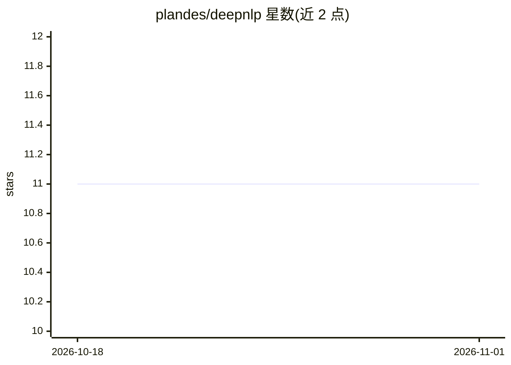

# plandes/deepnlp

⭐ 11 · HTML · NOASSERTION · 推送 2026-01-04 · [GitHub](https://github.com/plandes/deepnlp) · [官网](https://plandes.github.io/deepnlp/) · 个人维护

**面向实验与复现的深度学习 NLP 工具库**

DeepZensols 是基于 PyTorch 的自然语言处理深度学习工具库，出自 NLP-OSS 论文，目标是辅助特征工程与嵌入层构建。提供少代码即可配置的层：Glove/Word2Vec/fastText 词嵌入层、BERT 上下文词向量层、Embedding+BiLSTM-CRF 完整实现；以及将 spaCy 解析特征、依存树特征等数字化为批处理张量的 NLP 向量化器。附带文本分类、情感分析、命名实体识别三个参考模型，支持命令行训练/测试/预测与 Jupyter notebook。面向 NLP 研究与实验复现场景的开发者。

## 筛选速览

| 维度 | 判定 | 备注 |
|---|---|---|
| AI 角色 | `ai-native` | 本体是模型或模型工具 |
| 许可风险 | `none` | NOASSERTION |
| 部署形态 | `library` | 以包/库形式分发 |
| 模型依赖 | — | README 未给出锁定关系 |
| 硬件要求 | — | 无带数字的原话,不猜 |
| 安装摩擦 | `low` | 无编译、无系统依赖或容器化 |
| 成熟度 | — | 结构信号不足 |

## 能力要点

- 可配置词嵌入层（Glove/Word2Vec/fastText）与 Huggingface BERT 上下文向量层
- 完整 Embedding+BiLSTM-CRF 实现，各组成层可配置
- NLP 向量化器：spaCy 解析特征、依存树特征等转为批处理张量
- 三个参考模型（文本分类/情感分析/NER），提供命令行与 Jupyter notebook

## 适用场景

- 搭建可配置的 NLP 深度学习实验并保证可复现
- 做命名实体识别或文本分类的模型原型开发
- 在 BERT 词向量与 BiLSTM-CRF 架构上快速实验

## 场景标签

 · 领域:自然语言处理/深度学习工具库

## 证据(README 行号)

> L8: Deep learning utility library for natural language processing that aids in
> L20:  * Huggingface transformer ([BERT]) context based word vector layer.
> L21:  * Full [Embedding+BiLSTM-CRF] implementation using easy to configure

## 星数曲线

2026-10-18 11 → 2026-11-01 11（+0）

---
*卡片 v1 · prompt 1.4 · 生成 2026-11-01 · 置信度 high · 依据 README sha `f9192698dbbc` · [字段定义](../../DATASET.md)*
