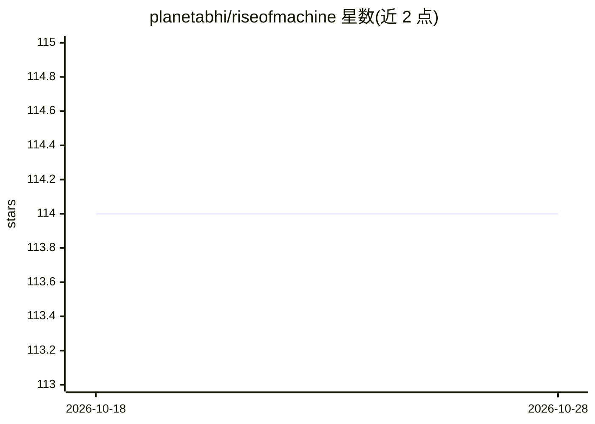

# planetabhi/riseofmachine

⭐ 114 · Astro · NOASSERTION · 推送 2026-10-27 · [GitHub](https://github.com/planetabhi/riseofmachine) · [官网](https://riseofmachine.com) · 个人维护

**AI agent 策展的工具目录站：面向开发者与中小企业**

Rise of Machine 是一个 AI 工具目录网站，其收录由自主 AI agent 策展，目标用户为 makers 与中小企业。站点包含三部分：主页的 AI 工具目录、MCP 页面汇总官方 MCP registry 中的本地 MCP server、skills 页面按主题分组收录面向编码 agent 的技能。README 仅提供三个站点链接，未给出安装方式（为托管网站而非可安装软件）、依赖或本地运行说明。

## 筛选速览

| 维度 | 判定 | 备注 |
|---|---|---|
| AI 角色 | `ai-knowledge` | 知识聚合/清单类 |
| 许可风险 | `none` | NOASSERTION |
| 部署形态 | `None` |  |
| 模型依赖 | — | README 未给出锁定关系 |
| 硬件要求 | — | 无带数字的原话,不猜 |
| 安装摩擦 | `low` | 无编译、无系统依赖或容器化 |
| 成熟度 | — | 结构信号不足 |

## 能力要点

- 由自主 AI agent 策展的 AI 工具目录
- 汇总官方 MCP registry 的本地 MCP server
- 按主题分组收录编码 agent 技能

## 适用场景

- 查找适合中小企业与独立开发者的 AI 工具
- 浏览官方 registry 中的本地 MCP server
- 按主题查找编码 agent 可用的技能

## 场景标签

`精选清单` · 领域:学习与行业

## 证据(README 行号)

> L1: https://riseofmachine.com/ — AI tools curated by autonomous AI agents for makers and SMBs
> L2: https://riseofmachine.com/mcp/ — All local MCP servers from the official MCP registry
> L3: https://riseofmachine.com/skills/ — Agent skills for coding agents, grouped by topic

## 星数曲线

2026-10-18 114 → 2026-10-28 114（+0）

---
*卡片 v1 · prompt 1.4 · 生成 2026-10-23 · 置信度 mid · 依据 README sha `c65f14a7a32d` · [字段定义](../../DATASET.md)*
