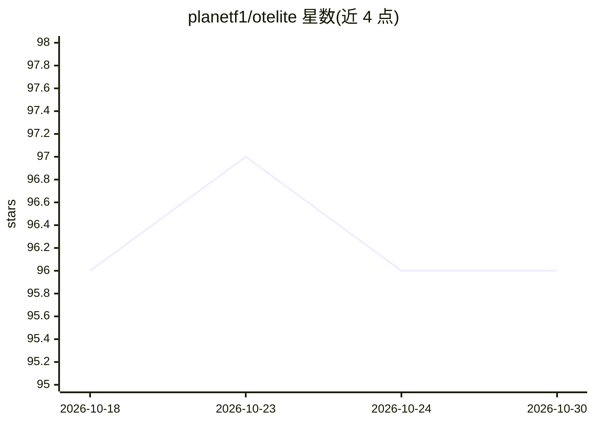

# planetf1/otelite

⭐ 96 · Rust · NOASSERTION · 推送 2026-10-16 · [GitHub](https://github.com/planetf1/otelite) · [官网](https://github.com/planetf1/otelite) · 个人维护

**本地 LLM 开发用的轻量 OpenTelemetry 接收与可视化工具**

单一二进制的 OpenTelemetry 可观测性工具：接收 OTLP gRPC/HTTP 的日志、追踪与指标，存入内嵌 SQLite，提供 Web 仪表盘、终端 TUI 与 CLI 查询导出。面向本地 LLM 开发场景，按 OTel GenAI 语义约定提供约 50 个分析面板：各提供商成本估算、含 TTFT 的延迟分位数、错误类型分布、模型漂移检测等。另内置 MCP server，可将遥测数据暴露给 Claude Code、Cursor 等 AI agent。自述为个人项目、尽力维护，版本 0.1.144 处于早期阶段。

## 筛选速览

| 维度 | 判定 | 备注 |
|---|---|---|
| AI 角色 | `ai-ecosystem` | LLM/agent 周边工具 |
| 许可风险 | `none` | NOASSERTION |
| 部署形态 | `library` | 以包/库形式分发 |
| 模型依赖 | — | README 未给出锁定关系 |
| 硬件要求 | — | 无带数字的原话,不猜 |
| 安装摩擦 | `low` | 无编译、无系统依赖或容器化 |
| 成熟度 | `idea` | |

## 能力要点

- 单一二进制零运行时依赖，空闲内存 <100MB、启动 <3s
- OTLP gRPC(4317)/HTTP(4318) 接收，SQLite 内嵌存储
- 约 50 个 GenAI/LLM 分析面板（成本、TTFT 延迟、错误类型、模型漂移等）
- otelite mcp 将日志/追踪/用量暴露给 AI agent；支持 JSONL 离线导入

## 适用场景

- 本地开发时查看 LLM 应用的日志、追踪与指标
- 分析各 LLM 提供商的 token 成本与延迟表现
- 在终端内用 TUI 检索遥测数据
- 让 Claude Code/Cursor 等 agent 通过 MCP 读取遥测信息

## 场景标签

`LLM 可观测性` · 领域:评测与运维

## 证据(README 行号)

> L10: Otelite is a single-binary observability tool that receives OpenTelemetry data (logs, traces, metrics) and provides
> L72: - **MCP server**: Expose logs, traces and GenAI usage to AI agents (Claude Code, Cursor, ...) via `otelite mcp`
> L75: - **GenAI/LLM analytics**: First-class OTel GenAI semconv — cost estimation per provider,

## 星数曲线

2026-10-18 96 → 2026-10-30 96（+0）

---
*卡片 v1 · prompt 1.4 · 生成 2026-10-23 · 置信度 high · 依据 README sha `520062d97997` · [字段定义](../../DATASET.md)*
