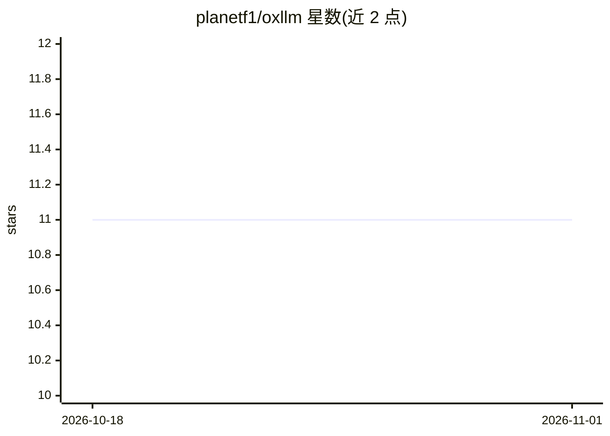

# planetf1/oxllm

⭐ 11 · Rust · Apache-2.0 · 推送 2026-10-28 · [GitHub](https://github.com/planetf1/oxllm) · 个人维护

**Rust 编写的 OpenAI 兼容 LLM 路由网关，带故障转移**

面向资源受限边缘设备（如 OpenWrt 路由器）、开发者工作站与后台守护进程的 LLM 代理网关：以 OpenAI 兼容接口接收请求，按虚拟模型定义的分层回退池转发到多个 LLM 提供商，内置速率限制检测、熔断器、指数退避、会话亲和与 OTel 遥测。状态全部驻留内存，零本地磁盘持久化，发布二进制约 2.6 MB、空闲内存约 14 MB。支持 Homebrew 与 cargo 安装，通过 SIGHUP 或 HTTP 端点热重载配置。主要场景为跨多个免费层云提供商路由与自动故障转移。

## 筛选速览

| 维度 | 判定 | 备注 |
|---|---|---|
| AI 角色 | `ai-ecosystem` | LLM/agent 周边工具 |
| 许可风险 | `permissive` | Apache-2.0 |
| 部署形态 | `library` | 以包/库形式分发 |
| 模型依赖 | local-ok | 支持本地模型 |
| 硬件要求 | — | 无带数字的原话,不猜 |
| 安装摩擦 | `medium` | 含编译或系统依赖之一 |
| 成熟度 | — | 结构信号不足 |

## 能力要点

- 分层故障转移：429/5xx 时按虚拟模型级联到下一提供商
- 熔断器 + 指数退避 + 空闲衰减的提供商健康管理
- 三种路由策略（priority/fastest/cheapest）与会话亲和
- 零磁盘依赖，二进制约 2.6 MB，空闲内存约 14 MB

## 适用场景

- 跨多个免费层 LLM 提供商做自动故障转移路由
- 在边缘设备或低资源环境运行本地 LLM 网关
- 为编辑器补全等客户端提供 /v1/completions 流式代理

## 场景标签

`模型网关` · 领域:Agent 开发

## 证据(README 行号)

> L8: `oxllm` (Oxide LLM Proxy) is an ultra-minimalist, high-resilience adaptive routing LLM gateway written in Rust. It e
> L10: Built to operate entirely in memory with zero local disk persistence, `oxllm` is optimized for resource-constrained

## 星数曲线

2026-10-18 11 → 2026-11-01 11（+0）

---
*卡片 v1 · prompt 1.4 · 生成 2026-11-01 · 置信度 high · 依据 README sha `b33f9a66e541` · [字段定义](../../DATASET.md)*
