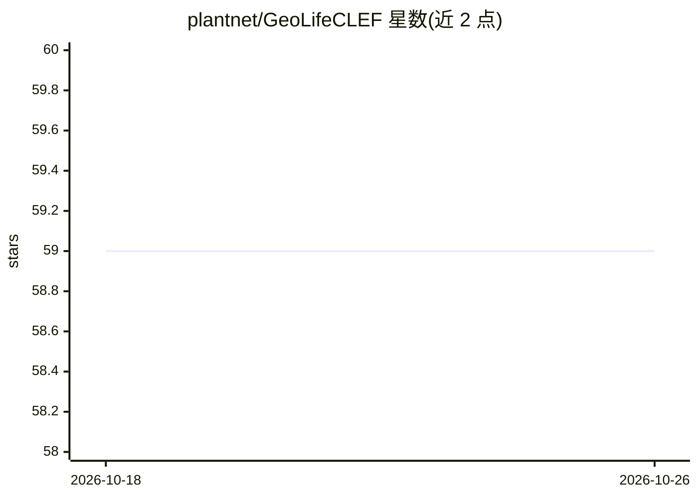

# plantnet/GeoLifeCLEF

⭐ 59 · Jupyter Notebook · MIT · 推送 2026-03-05 · [GitHub](https://github.com/plantnet/GeoLifeCLEF) · 组织维护

**GeoLifeCLEF 物种分布建模竞赛的工具包与入门代码**

Pl@ntNet 维护的 GeoLifeCLEF 竞赛配套工具库：提供访问竞赛数据集的 dataloaders、小规模示例数据（sample_data），以及基于 PyTorch 的 CNN 张量与时间序列张量数据集构建示例（notebook 与 Python 脚本两种形式）。通过 conda environment.yml 创建环境（glc23）运行。适用于参加或复现 GeoLifeCLEF 2022–2025 物种分布建模竞赛的研究者与开发者。

## 筛选速览

| 维度 | 判定 | 备注 |
|---|---|---|
| AI 角色 | `ai-ecosystem` | LLM/agent 周边工具 |
| 许可风险 | `permissive` | MIT |
| 部署形态 | `None` |  |
| 模型依赖 | — | README 未给出锁定关系 |
| 硬件要求 | — | 无带数字的原话,不猜 |
| 安装摩擦 | `low` | 无编译、无系统依赖或容器化 |
| 成熟度 | — | 结构信号不足 |

## 能力要点

- 竞赛数据集的 dataloaders 与示例数据
- PyTorch CNN 张量与时间序列张量数据集构建示例
- 提供 conda 环境文件（glc23）

## 适用场景

- 参加 GeoLifeCLEF 竞赛时快速搭建数据处理流程
- 基于示例数据试验和调试数据加载代码

## 场景标签

`科研工具` · 领域:学习与行业

## 证据(README 行号)

> L10: In this repository, you will find dataloaders, sample_data, and examples to help using the challenge datasets.
> L12: - ``example_patch_loading.ipynb`` and ``example_patch_loading.py`` give an example of pytorch dataset creation for 

## 星数曲线

2026-10-18 59 → 2026-10-26 59（+0）

---
*卡片 v1 · prompt 1.4 · 生成 2026-10-24 · 置信度 mid · 依据 README sha `fd70424491ec` · [字段定义](../../DATASET.md)*
