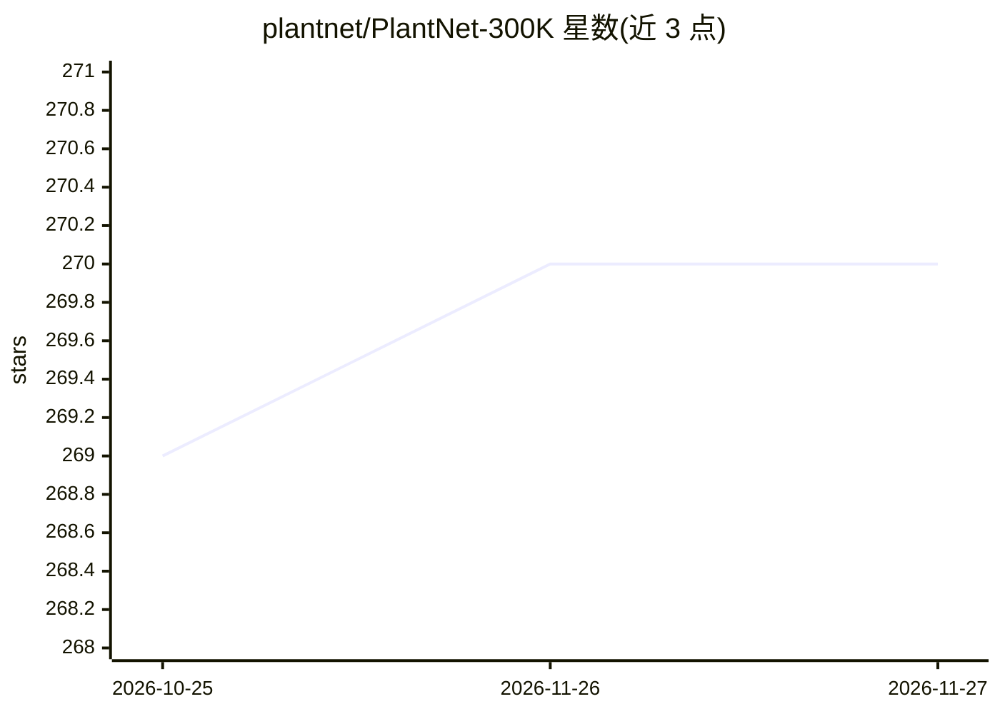

# plantnet/PlantNet-300K

⭐ 270 · Python · BSD-2-Clause · 推送 2026-10-30 · [GitHub](https://github.com/plantnet/PlantNet-300K) · [官网](https://doi.org/10.5281/zenodo.5645731) · 组织维护

**植物图像长尾分类数据集及训练代码：面向植物识别研究者**

Pl@ntNet-300K-v2 数据集仓库，含 306,087 张图像、1,000 个植物物种，保留长尾类分布与高视觉模糊特性，附 CSV 元数据（物种名、IUCN 状态、逐图许可与署名信息）。仓库提供基于 DINOv3 的 ConvNeXt/ViT 骨干 PyTorch 微调与推理代码，支持 6 种架构配置，提供微调模型权重下载及嵌入/logits 提取接口；DINOv3 初始权重为 Hugging Face 许可门控，需先认证。原 v1 基准代码保留于 legacy_v1/。面向细粒度视觉识别研究者。

## 筛选速览

| 维度 | 判定 | 备注 |
|---|---|---|
| AI 角色 | `ai-native` | 本体是模型或模型工具 |
| 许可风险 | `permissive` | BSD-2-Clause |
| 部署形态 | `library` | 以包/库形式分发 |
| 模型依赖 | — | README 未给出锁定关系 |
| 硬件要求 | — | 无带数字的原话,不猜 |
| 安装摩擦 | `medium` | 含编译或系统依赖之一 |
| 成熟度 | — | 结构信号不足 |

## 能力要点

- 306,087 张图像、1,000 物种，长尾分布与高标签模糊数据集
- 6 种 DINOv3 微调架构（ConvNeXt-T/S/B 与 ViT-S/S+/B）
- 提供微调模型权重下载与嵌入/logits 提取接口
- 支持 Weights & Biases 运行日志

## 适用场景

- 研究长尾分布下的植物图像分类
- 在标签模糊的细粒度数据集上训练与评测模型
- 提取植物图像嵌入用于下游任务

## 场景标签

`模型评测` `微调` · 领域:评测与运维

## 证据(README 行号)

> L3: This repository contains training and inference code for **Pl@ntNet-300K-v2**.
> L11: Pl@ntNet-300K-v2 contains **306,087 images from 1,000 plant species**. It retains
> L54: python main.py \

## 星数曲线

2026-10-25 269 → 2026-11-27 270（+1）

---
*卡片 v1 · prompt 1.4 · 生成 2026-11-25 · 置信度 high · 依据 README sha `a006081a5bef` · [字段定义](../../DATASET.md)*
