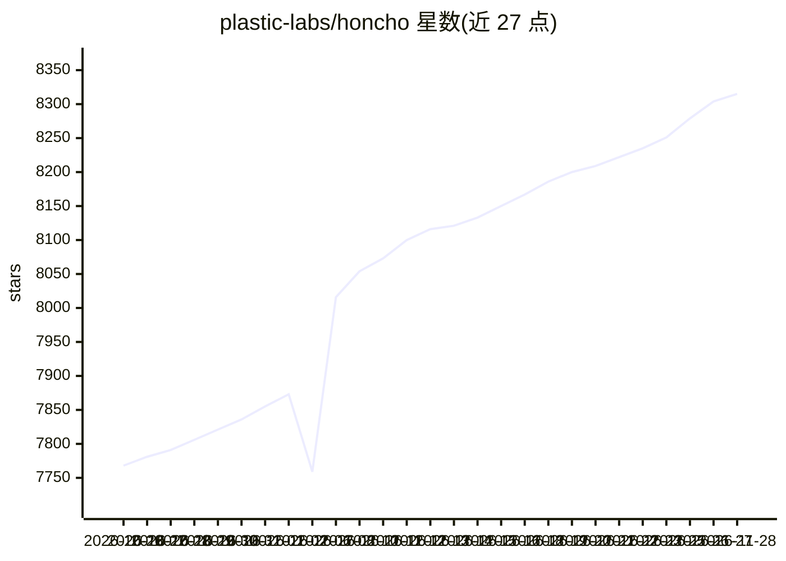

# plastic-labs/honcho

⭐ 8,315 · Python · AGPL-3.0 · 推送 2026-11-25 · [GitHub](https://github.com/plastic-labs/honcho) · [官网](https://honcho.dev/docs) · 组织维护

**给有状态 Agent 提供记忆基础设施：存储消息并后台推理生成可查询表示**

以 PyPI/npm SDK、CLI、托管 API 与自托管 FastAPI 服务形式提供的 Agent 记忆基础设施。工作流为四步循环：将对话/事件/文档存入 session，后台队列推理更新每个 peer 的表示，再通过 Chat Endpoint、representation 或混合搜索（BM25+向量）查询结果，注入到任意 LLM 调用。核心概念为 workspace/peer/session/scope/message，peer 涵盖人类与 AI Agent。提供 Python 与 TypeScript SDK，后台推理为异步，新消息需等待处理后反映到响应。

## 筛选速览

| 维度 | 判定 | 备注 |
|---|---|---|
| AI 角色 | `ai-ecosystem` | LLM/agent 周边工具 |
| 许可风险 | `viral` | AGPL-3.0 |
| 部署形态 | `self-host` | docker 或自建部署 |
| 模型依赖 | — | README 未给出锁定关系 |
| 硬件要求 | — | 无带数字的原话,不猜 |
| 安装摩擦 | `low` | 无编译、无系统依赖或容器化 |
| 成熟度 | — | 结构信号不足 |

## 能力要点

- peer 中心模型：以 (observer, observed) 对组织集合与向量文档，支持跨 peer 建模与自我表示
- Hybrid search（BM25+向量）与低延迟静态 representation 端点
- 为 Claude Code、Cursor、Codex 等编码 Agent 提供第一方记忆插件，共用一份 ~/.honcho/config.json
- 三种运行方式：托管 api.honcho.dev、本地 `honcho start`、自托管 FastAPI 服务器

## 适用场景

- 给我的编码 Agent（Claude Code/Cursor 等）接持久记忆
- 在我的产品中通过 Python/TypeScript SDK 加入用户级记忆
- 本地用 Docker 跑一套记忆栈供开发调试
- 多人与多 Agent 混合会话中维护各参与者的状态表示

## 场景标签

`Agent 记忆` · 领域:Agent 开发

## 证据(README 行号)

> L11: **Honcho is memory infrastructure for building stateful agents that understand changing people, agents, groups, pro
> L13: Store messages and events, let Honcho reason in the background, then query peer representations, session context, s
> L46: 4. **Inject** — drop the result into any LLM call or agent framework.

## 星数曲线

2026-10-26 7,768 → 2026-11-28 8,315（+547）

---
*卡片 v1 · prompt 1.4 · 生成 2026-11-26 · 置信度 high · 依据 README sha `84d465d09d19` · [字段定义](../../DATASET.md)*
