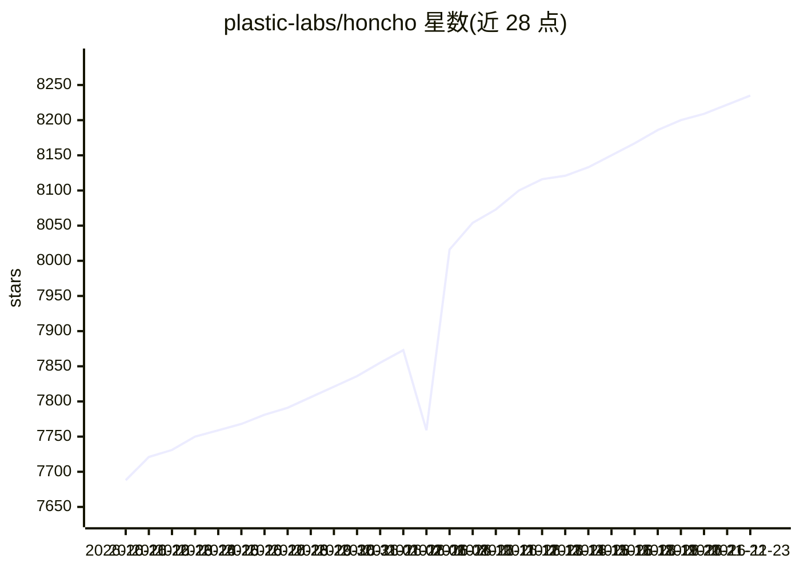

# plastic-labs/honcho

⭐ 8,235 · Python · AGPL-3.0 · 推送 2026-11-21 · [GitHub](https://github.com/plastic-labs/honcho) · [官网](https://honcho.dev/docs) · 组织维护

**为有状态 agent 提供记忆基础设施的库与服务**

Honcho 提供消息/事件存储与后台推理，为跨时间的用户、agent、群组等实体（peer）构建可查询的表示，支持上下文检索、混合搜索（BM25+向量）、自然语言洞察与结论 API。提供托管服务、CLI 本地栈与 FastAPI 自托管三种运行方式，配 Python/TypeScript SDK，并为 Claude Code、Cursor、Codex 等编码 agent 提供插件与 MCP 接入。

## 筛选速览

| 维度 | 判定 | 备注 |
|---|---|---|
| AI 角色 | `ai-ecosystem` | LLM/agent 周边工具 |
| 许可风险 | `viral` | AGPL-3.0 |
| 部署形态 | `self-host` | docker 或自建部署 |
| 模型依赖 | — | README 未给出锁定关系 |
| 硬件要求 | — | 无带数字的原话,不猜 |
| 安装摩擦 | `low` | 无编译、无系统依赖或容器化 |
| 成熟度 | — | 结构信号不足 |

## 能力要点

- Store→Reason→Query→Inject 的记忆闭环，后台异步推理
- peer 中心模型：支持多参与者会话与跨 peer 视角建模
- 混合搜索（BM25 + 向量）与低延迟静态表示接口
- CLI 一条命令为多个编码 agent 安装记忆插件

## 适用场景

- 给编码 agent 添加跨会话的持久记忆
- 在产品中接入用户与 agent 的长期画像与上下文检索
- 自托管或本地运行一套 agent 记忆服务

## 场景标签

`Agent 记忆` · 领域:Agent 开发

## 证据(README 行号)

> L11: **Honcho is memory infrastructure for building stateful agents that understand changing people, agents, groups, pro
> L13: Store messages and events, let Honcho reason in the background, then query peer representations, session context, s
> L102: Honcho ships a first-party memory plugin for every major coding agent. They all read the same

## 星数曲线

2026-10-21 7,688 → 2026-11-23 8,235（+547）

---
*卡片 v1 · prompt 1.4 · 生成 2026-11-23 · 置信度 high · 依据 README sha `87dbd11c7b1f` · [字段定义](../../DATASET.md)*
