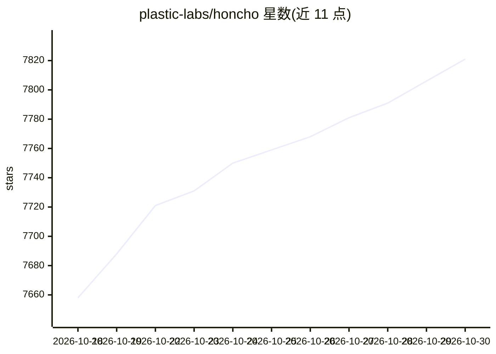

# plastic-labs/honcho

⭐ 7,821 · Python · AGPL-3.0 · 推送 2026-10-29 · [GitHub](https://github.com/plastic-labs/honcho) · [官网](https://honcho.dev/docs) · 组织维护

**给 agent 开发者的记忆基础设施：存储-推理-查询的持久记忆层**

面向构建有状态 agent 的记忆基础设施：应用通过 Python/TypeScript SDK 把会话消息、事件与文档存入 Honcho，后台异步推理从对话中抽取结论并构建 per-peer 表示，再以 Chat 端点、上下文包、混合搜索（BM25+向量）或静态表示等形式查询，注入任意 LLM 调用或框架。支持 api.honcho.dev 托管、`honcho start` 本地 Docker 栈或自行部署 FastAPI 服务器（AGPL-3.0）。为 Claude Code、Codex、Cursor、OpenCode 等编码 agent 提供一方记忆插件与 MCP 接入。限制：后台推理异步，低延迟读取需用 representation 端点。

## 筛选速览

| 维度 | 判定 | 备注 |
|---|---|---|
| AI 角色 | `ai-ecosystem` | LLM/agent 周边工具 |
| 许可风险 | `viral` | AGPL-3.0 |
| 部署形态 | `self-host` | docker 或自建部署 |
| 模型依赖 | — | README 未给出锁定关系 |
| 硬件要求 | — | 无带数字的原话,不猜 |
| 安装摩擦 | `low` | 无编译、无系统依赖或容器化 |
| 成熟度 | — | 结构信号不足 |

## 能力要点

- 存储-后台推理-查询-注入的记忆循环，peer-centric 实体建模
- 混合搜索（BM25+向量）与 prompt-ready 上下文（to_openai/to_anthropic）
- 为 8 种主流编码 agent 提供一方记忆插件，统一 ~/.honcho/config.json
- 托管 / CLI 本地 Docker 栈 / 源码自部署三种运行方式

## 适用场景

- 给我的编码 agent 加跨会话持久记忆
- 多 agent / 多人参与的会话中维护每个参与者的画像与上下文
- 为产品中的 LLM 功能提供可查询的长期记忆后端

## 场景标签

`Agent 记忆` `多智能体` · 领域:Agent 开发

## 证据(README 行号)

> L11: **Honcho is memory infrastructure for building stateful agents that understand changing people, agents, groups, pro
> L13: Store messages and events, let Honcho reason in the background, then query peer representations, session context, s
> L43: 1. **Store** conversations, events, documents, or tool traces as messages on a session.

## 星数曲线

2026-10-18 7,658 → 2026-10-30 7,821（+163）

---
*卡片 v1 · prompt 1.4 · 生成 2026-10-20 · 置信度 high · 依据 README sha `8b88a081d720` · [字段定义](../../DATASET.md)*
