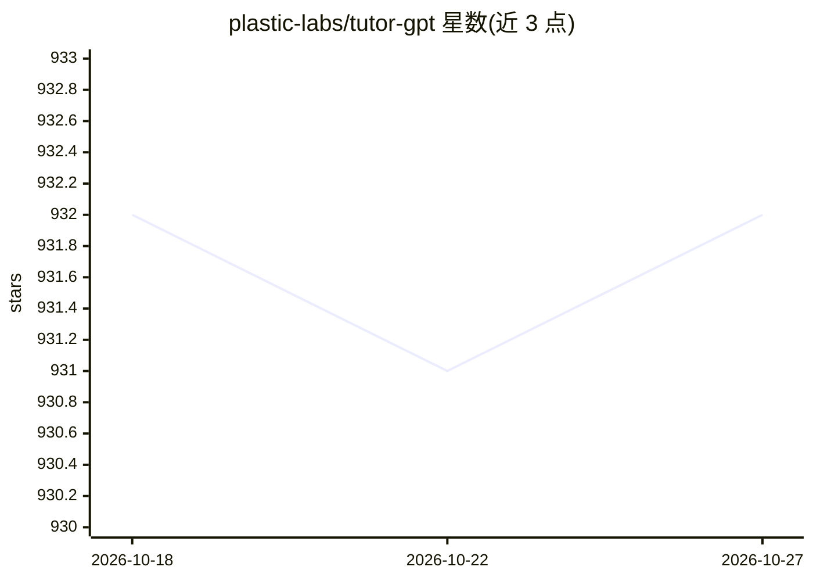

# plastic-labs/tutor-gpt

⭐ 932 · TypeScript · GPL-3.0 · 推送 2026-02-20 · [GitHub](https://github.com/plastic-labs/tutor-gpt) · [官网](https://discord.gg/plasticlabs) · 组织维护

**面向学习者的 LLM 对话辅导应用，动态更新自身提示词**

由 Plastic Labs 开发的 Next.js 学习伴侣应用：基于 LLM 对话辅导，动态推理学习需求并更新自身提示词；通过 Honcho 构建用户表示实现个性化。依赖 Supabase（认证/数据库）、Openrouter（LLM 接入）、Stripe（支付）、PostHog 等第三方服务。自托管需配置多项环境变量，支持 pnpm 源码运行与 Docker 镜像构建。托管版本名为 Bloom。

## 筛选速览

| 维度 | 判定 | 备注 |
|---|---|---|
| AI 角色 | `ai-native` | 本体是模型或模型工具 |
| 许可风险 | `viral` | GPL-3.0 |
| 部署形态 | `self-host` | docker 或自建部署 |
| 模型依赖 | locked-api |  |
| 硬件要求 | — | 无带数字的原话,不猜 |
| 安装摩擦 | `low` | 无编译、无系统依赖或容器化 |
| 成熟度 | — | 结构信号不足 |

## 能力要点

- 动态推理学习需求并更新自身提示词
- 基于 Honcho 的用户表示与个性化
- Next.js 全栈应用，支持 OpenAI 兼容 API 端点
- 提供 Dockerfile 便于自托管

## 适用场景

- 自托管一个 LLM 学习辅导对话应用
- 作为语言/读写辅导的对话学习伴侣
- 在其基础上二次开发个性化教育应用

## 场景标签

`聊天机器人` · 领域:对话与助手

## 证据(README 行号)

> L14: Tutor-GPT is an LLM powered learning companion developed by [Plastic
> L16: and _updates its own prompts_ to best serve you.

## 星数曲线

2026-10-18 932 → 2026-10-27 932（+0）

---
*卡片 v1 · prompt 1.4 · 生成 2026-10-21 · 置信度 mid · 依据 README sha `43c8d8141515` · [字段定义](../../DATASET.md)*
