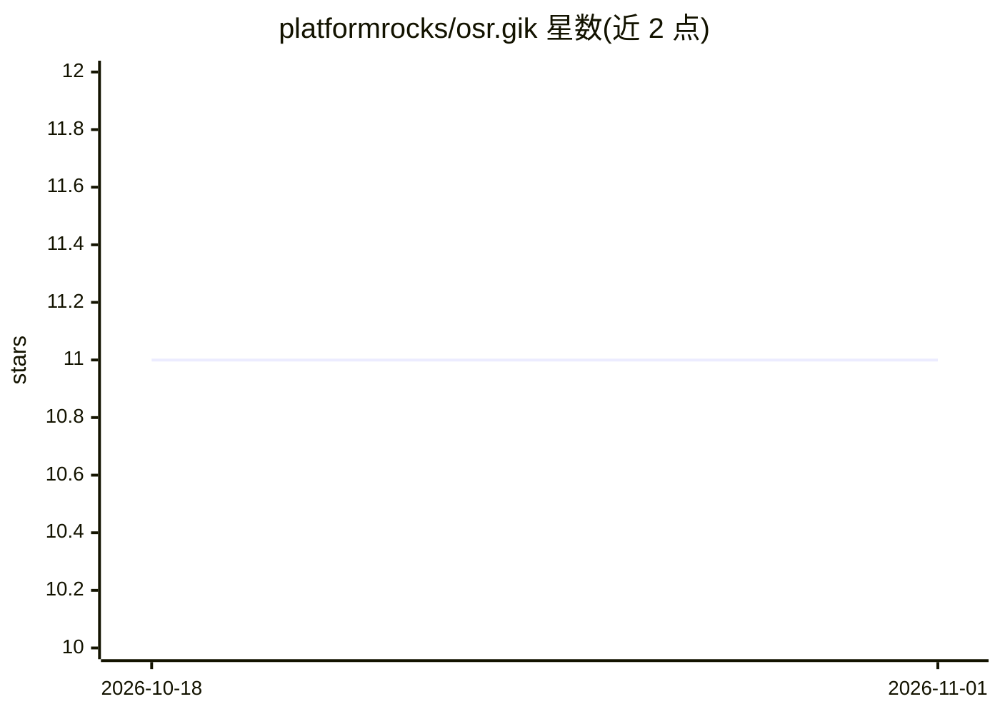

# platformrocks/osr.gik

⭐ 11 · Rust · MIT · 推送 2025-12-12 · [GitHub](https://github.com/platformrocks/osr.gik) · 组织维护

**面向软件项目的本地优先知识引擎：Git 式索引代码库知识**

Rust 编写的本地优先知识引擎，以类似 Git 的工作流跟踪代码库知识的演进。提供混合检索（BM25+向量、RRR 融合）、Cross-Encoder 重排、13 种语言的知识图谱符号抽取、结构化记忆与项目栈清单；CLI 提供类似 Git 的命令（init/add/commit/ask/release 等），知识随 Git 分支自动对齐，可通过 gik ask 做 RAG 查询。全部操作离线运行、不调用 LLM；支持 Metal 与 CUDA 加速。声明为 experimental。

## 筛选速览

| 维度 | 判定 | 备注 |
|---|---|---|
| AI 角色 | `ai-ecosystem` | LLM/agent 周边工具 |
| 许可风险 | `permissive` | MIT |
| 部署形态 | `None` |  |
| 模型依赖 | — | README 未给出锁定关系 |
| 硬件要求 | — | 无带数字的原话,不猜 |
| 安装摩擦 | `medium` | 含编译或系统依赖之一 |
| 成熟度 | `idea` | |

## 能力要点

- BM25+向量混合检索与 RRF 融合、Cross-Encoder 重排
- 13 种语言的知识图谱符号抽取
- Git 式工作流（init/add/commit/reindex），随 Git 分支自动对齐
- 本地优先，全部操作离线、不调用 LLM

## 适用场景

- 为代码库建立可查询的知识索引并随分支演进
- 离线语义检索代码、文档与项目结构
- 记录并检索项目中的事件、决策与理由
- 自动生成 CHANGELOG

## 场景标签

`知识图谱` `RAG` `语义搜索` · 领域:知识与检索

## 证据(README 行号)

> L5: **GIK is a local-first knowledge engine for software projects.** Think of it as Git for knowledge-while Git tracks t
> L8: - **RAG (Retrieval-Augmented Generation)** – Semantic search over code, docs, and structured data
> L21: - **Local-First**: All operations work fully offline, no LLM calls

## 星数曲线

2026-10-18 11 → 2026-11-01 11（+0）

---
*卡片 v1 · prompt 1.4 · 生成 2026-11-01 · 置信度 high · 依据 README sha `b7b8e6ff6b30` · [字段定义](../../DATASET.md)*
