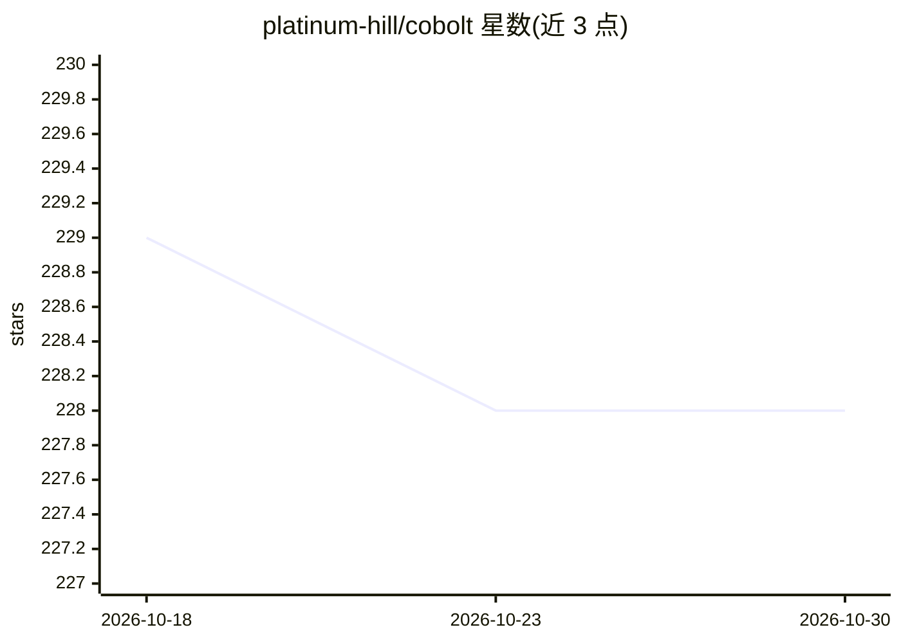

# platinum-hill/cobolt

⭐ 228 · TypeScript · NOASSERTION · 推送 2026-03-02 · [GitHub](https://github.com/platinum-hill/cobolt) · 组织维护

**本地运行 LLM 的跨平台桌面 AI 助手，数据不出设备**

基于 Electron 的跨平台桌面应用（macOS/Windows/Linux），通过 Ollama 使用本地模型对话并执行操作，默认推理模型为 llama3.2:3b、嵌入模型为 nomic-embed-text。数据与记忆仅存储在本机设备。支持通过 MCP 协议接入工具与数据源（配置格式与 Claude Desktop 相同），提供原生记忆功能以生成个性化回答。README 声明为早期版本，预期不稳定且可能显著变化。Linux 运行前需执行脚本安装依赖。

## 筛选速览

| 维度 | 判定 | 备注 |
|---|---|---|
| AI 角色 | `ai-native` | 本体是模型或模型工具 |
| 许可风险 | `none` | NOASSERTION |
| 部署形态 | `desktop` | 安装包/桌面程序 |
| 模型依赖 | local-ok | 支持本地模型 |
| 硬件要求 | — | 无带数字的原话,不猜 |
| 安装摩擦 | `low` | 无编译、无系统依赖或容器化 |
| 成熟度 | `idea` | |

## 能力要点

- 基于 Ollama 的本地模型推理，数据不离开设备
- MCP 协议接入工具与数据源，配置格式兼容 Claude Desktop
- 本机存储的原生记忆功能，支持个性化回答
- 提供 macOS/Windows/Linux 三平台安装包

## 适用场景

- 在本地设备上与 LLM 对话而不上传数据
- 通过 MCP 把本地模型接入我的工具和数据源
- 让 AI 助手记住我的偏好以获得个性化回答

## 场景标签

`AI 助手` · 领域:对话与助手

## 证据(README 行号)

> L23: Cobolt is a cross-platform desktop application that enables you to get answers, and perform actions on the data tha
> L41: - Local Models: Ensures that your data does not leave your device. We are powered by Ollama, which enables you to u

## 星数曲线

2026-10-18 229 → 2026-10-30 228（-1）

---
*卡片 v1 · prompt 1.4 · 生成 2026-10-22 · 置信度 high · 依据 README sha `24daa887bb56` · [字段定义](../../DATASET.md)*
