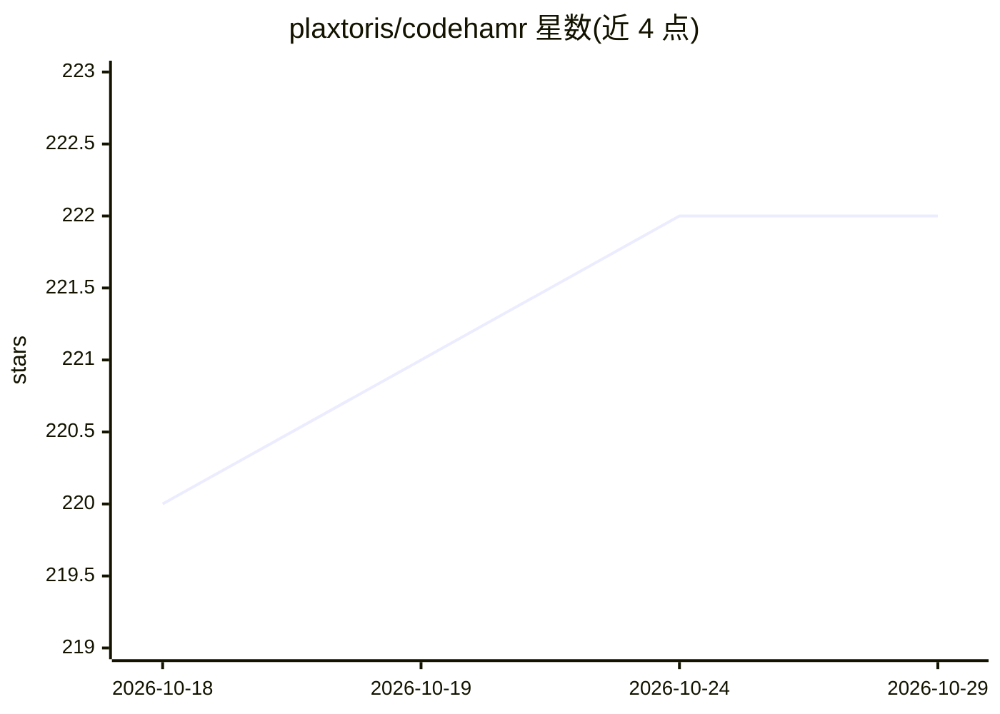

# plaxtoris/codehamr

⭐ 222 · Go · MIT · 推送 2026-09-25 · [GitHub](https://github.com/plaxtoris/codehamr) · 个人维护

**终端里的极简本地优先编程 agent，连接自选模型服务**

MIT 许可的独立终端编程 agent，通过 bash、read_file、write_file、edit_file 四个工具读取项目、修改代码并运行检查。不绑定账号或订阅，通过配置 profile 接入本地模型服务器或 API 提供方（默认 local，示例含 OpenRouter），使用 Responses API 流式调用与函数工具。配置为单个 YAML 文件，含两个斜杠命令与一个内嵌系统提示。自身不提供沙箱，shell 命令以用户权限执行，建议在 devcontainer 或虚拟机中隔离。Windows 需在 WSL2 或 Linux devcontainer 中运行。

## 筛选速览

| 维度 | 判定 | 备注 |
|---|---|---|
| AI 角色 | `ai-native` | 本体是模型或模型工具 |
| 许可风险 | `permissive` | MIT |
| 部署形态 | `None` |  |
| 模型依赖 | local-ok | 支持本地模型 |
| 硬件要求 | — | 无带数字的原话,不猜 |
| 安装摩擦 | `medium` | 含编译或系统依赖之一 |
| 成熟度 | — | 结构信号不足 |

## 能力要点

- 四个工具（bash/read_file/write_file/edit_file）驱动的代码修改与检查流程
- 通过 profile 配置接入本地模型服务器或 OpenRouter 等 API 提供方
- Responses API 流式调用与函数工具，支持环境变量引用 API key
- 启动检查 GitHub 更新，可用 CODEHAMR_NO_UPDATE_CHECK=1 关闭

## 适用场景

- 在终端中让 agent 直接修改项目代码并运行验证
- 配合本地 Ollama 模型服务器离线使用
- 通过 OpenRouter 等托管 API 在多模型间切换

## 场景标签

`编码 Agent` · 领域:编码与开发

## 证据(README 行号)

> L9: The agent works through four tools: `bash`, `read_file`, `write_file`, and
> L10: `edit_file`. It reads your project, makes changes, runs checks, and replies when
> L4: Connect a local model server or an API provider of your choice. No project account

## 星数曲线

2026-10-18 220 → 2026-10-29 222（+2）

---
*卡片 v1 · prompt 1.4 · 生成 2026-10-22 · 置信度 high · 依据 README sha `57c26e0d2e75` · [字段定义](../../DATASET.md)*
