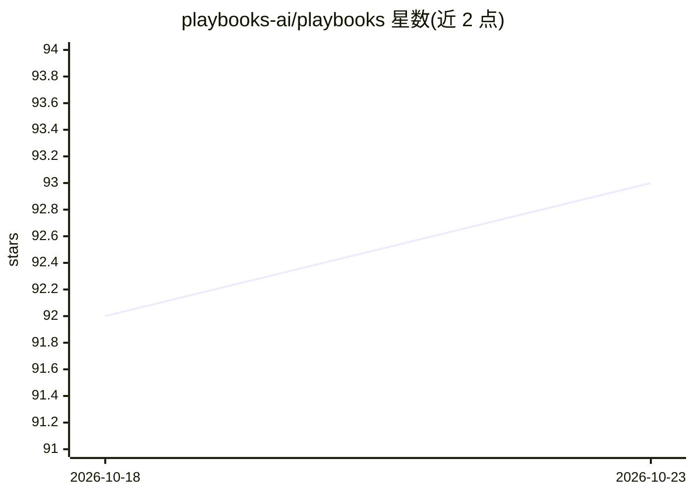

# playbooks-ai/playbooks

⭐ 93 · Python · MIT · 推送 2026-08-11 · [GitHub](https://github.com/playbooks-ai/playbooks) · [官网](https://runplaybooks.ai) · 组织维护

**用英文自然语言编写 AI agent 程序的编程系统与运行时**

面向开发者的 agent 框架：以 markdown 编写程序，编译器将其编译为语义指令集，由运行时在 LLM 上执行，提供真实调用栈、断点调试与控制流验证；自然语言 playbook 与 Python 函数可在同一调用栈与变量集内互相调用。内置多 agent 会议、事件驱动触发、上下文折叠等机制。安装需 Python 3.12+ 与 Anthropic API key（.env.example 列有其他支持的 provider），通过 pip 安装，附 CLI 与浏览器 playground，并有 VSCode 调试扩展。

## 筛选速览

| 维度 | 判定 | 备注 |
|---|---|---|
| AI 角色 | `ai-ecosystem` | LLM/agent 周边工具 |
| 许可风险 | `permissive` | MIT |
| 部署形态 | `library` | 以包/库形式分发 |
| 模型依赖 | — | README 未给出锁定关系 |
| 硬件要求 | — | 无带数字的原话,不猜 |
| 安装摩擦 | `low` | 无编译、无系统依赖或容器化 |
| 成熟度 | — | 结构信号不足 |

## 能力要点

- markdown 程序编译为语义指令集并在 LLM 上执行
- 自然语言与 Python 共享同一调用栈和变量集
- playbook 返回时执行轨迹折叠为返回值以控制上下文
- VSCode 扩展支持对自然语言步骤设断点、查看调用栈与变量

## 适用场景

- 用接近规格说明的自然语言编写并运行多 agent 流程
- 让业务流程负责人直接阅读可执行的程序逻辑
- 在 VSCode 中逐步调试 agent 的自然语言步骤

## 场景标签

`Agent 框架` `多智能体` · 领域:Agent 开发

## 证据(README 行号)

> L20: Playbooks programs are markdown. The compiler turns them into a semantic instruction set, and the runtime executes 
> L74: You will need Python 3.12+ and an Anthropic API key.

## 星数曲线

2026-10-18 92 → 2026-10-23 93（+1）

---
*卡片 v1 · prompt 1.4 · 生成 2026-10-23 · 置信度 high · 依据 README sha `90d4d24b33d9` · [字段定义](../../DATASET.md)*
