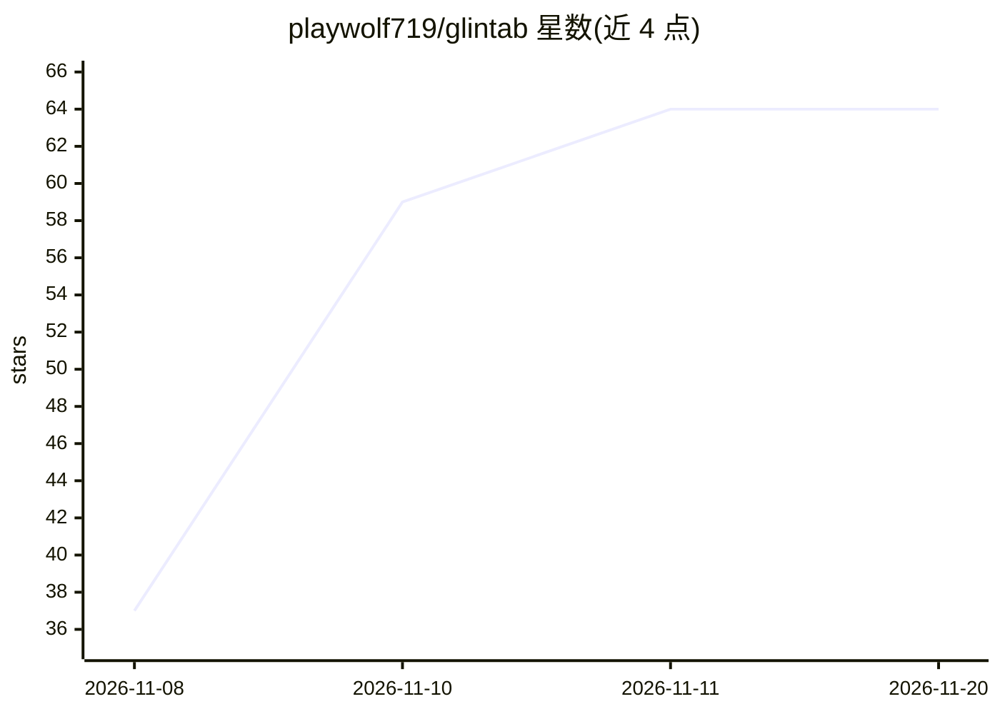

# playwolf719/glintab

⭐ 64 · TypeScript · 推送 2026-11-12 · [GitHub](https://github.com/playwolf719/glintab) · 个人维护 · 中文 README

**浏览器阅读助手插件：网页旁用自选 AI 模型摘要与追问**

Chrome 浏览器扩展（MV3，需 Chrome 116+），在网页旁对正文生成摘要、多轮追问，并提供提取正文查看器供核对依据。支持 OpenAI 兼容服务、Anthropic 与本机 Ollama 等多供应商切换，可导入 Claude Code/Codex/OpenCode 配置。支持 YouTube 与 B 站字幕提取、时间戳链接、可选 B 站音轨转写；会话与最近 10 个网址本地保存，无自建中转服务器。限制：API Key 本地未加密存储，不支持 OCR/PDF/直播/视频画面理解，视频站点真实验证有限。已上架 Chrome 应用商店，也可从源码构建（Node.js 22.12+）。

## 筛选速览

| 维度 | 判定 | 备注 |
|---|---|---|
| AI 角色 | `ai-native` | 本体是模型或模型工具 |
| 许可风险 | `none` | — |
| 部署形态 | `library` | 以包/库形式分发 |
| 模型依赖 | local-ok | 支持本地模型 |
| 硬件要求 | — | 无带数字的原话,不猜 |
| 安装摩擦 | `low` | 无编译、无系统依赖或容器化 |
| 成熟度 | `idea` | |

## 能力要点

- 网页旁摘要、多轮追问与提取正文核对（复制/导出 Markdown）
- 多供应商接入：OpenAI 兼容协议、Anthropic Messages、本机 Ollama、ChatGPT 账号授权
- YouTube / B 站字幕提取与时间戳链接，可选 B 站音轨转写
- 数据本地保存，无遥测/广告/云同步

## 适用场景

- 读长网页文章时先看摘要再围绕原文追问
- 在 YouTube / B 站视频旁梳理字幕重点并跳转时间戳
- 为特定域名定制摘要指令，按自己的方式总结
- 用自备的模型服务（含本机 Ollama）做阅读总结

## 场景标签

`文档问答` · 领域:知识与检索

## 证据(README 行号)

> L3:  阅读，从理解开始。
> L4:  用自己的 AI 模型，在网页旁提炼重点、核对原文、继续追问。
> L26: |用习惯的模型|多供应商切换，支持 OpenAI 兼容协议、Anthropic 与本机 Ollama|

## 星数曲线

2026-11-08 37 → 2026-11-20 64（+27）

---
*卡片 v1 · prompt 1.4 · 生成 2026-11-18 · 置信度 mid · 依据 README sha `a3d8ecad27de` · [字段定义](../../DATASET.md)*
