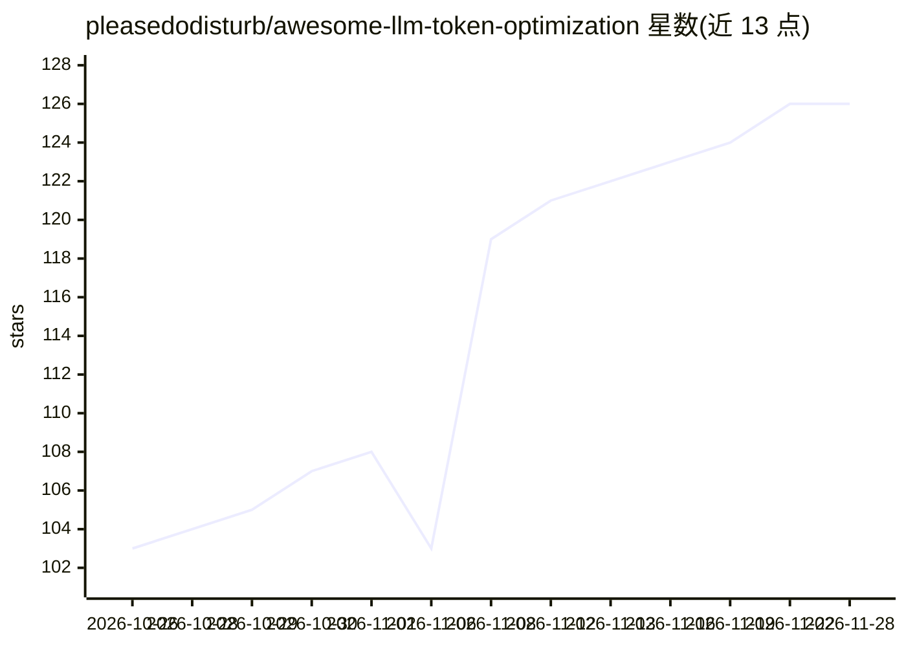

# pleasedodisturb/awesome-llm-token-optimization

⭐ 126 · Shell · NOASSERTION · 推送 2026-11-22 · [GitHub](https://github.com/pleasedodisturb/awesome-llm-token-optimization) · 个人维护

**降低 LLM token 成本的策略、工具与论文清单**

以 awesome-list 形式组织的生产环境 LLM 降本资源合集，收录策略、工具、论文与文档链接，按 Prompt Caching、Batch APIs、Model Routing、Prompt Compression、KV Cache 等主题分节。每条 Quick Win 附带量化的节省幅度、实施成本与来源链接；设有已撤回/更正条目区块，记录定期审计中被退休或修正的结论以保持可追溯。维护者按最后提交时间、许可变更等标准移除失修条目。无代码发行，仅文档清单。

## 筛选速览

| 维度 | 判定 | 备注 |
|---|---|---|
| AI 角色 | `ai-knowledge` | 知识聚合/清单类 |
| 许可风险 | `none` | NOASSERTION |
| 部署形态 | `None` |  |
| 模型依赖 | — | README 未给出锁定关系 |
| 硬件要求 | — | 无带数字的原话,不猜 |
| 安装摩擦 | `low` | 无编译、无系统依赖或容器化 |
| 成熟度 | — | 结构信号不足 |

## 能力要点

- Quick Wins 表列出各策略的节省幅度、实施成本与数据来源
- 已撤回/更正条目区块保留变更记录以供审计
- 覆盖缓存、批处理、模型路由、压缩、KV Cache 等多类降本手段
- 标注条目的维护状态与最后提交时间

## 适用场景

- 为生产环境的 LLM 应用查找降低 token 成本的方案
- 对比各服务商的 prompt caching 与 batch API 折扣细节
- 选型 token 优化相关的开源工具或框架

## 场景标签

`精选清单` · 领域:学习与行业

## 证据(README 行号)

> L3: > A curated list of strategies, tools, papers, and resources for reducing LLM token costs and improving efficiency i
> L11: Hit list as of 2026-10-25: the best single levers, with verified savings and where each number comes from.
> L28: Entries retired or corrected in the October 2026 sweeps, kept visible so the change is auditable.

## 星数曲线

2026-10-26 103 → 2026-11-28 126（+23）

---
*卡片 v1 · prompt 1.4 · 生成 2026-11-28 · 置信度 high · 依据 README sha `8cc30ac376b8` · [字段定义](../../DATASET.md)*
