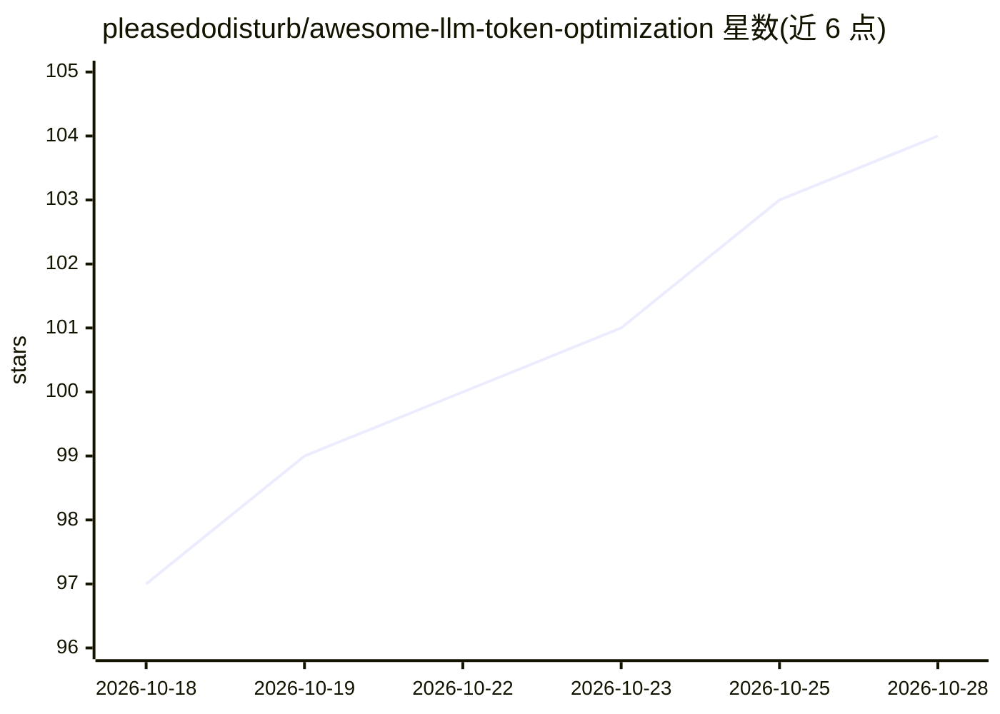

# pleasedodisturb/awesome-llm-token-optimization

⭐ 104 · Shell · NOASSERTION · 推送 2026-10-25 · [GitHub](https://github.com/pleasedodisturb/awesome-llm-token-optimization) · 个人维护

**降低 LLM token 成本的策略/工具/论文策展清单**

面向生产环境 LLM 应用的成本优化资源清单：按提示缓存、批量 API、模型路由、提示压缩、上下文窗口管理等主题组织，收录各厂商（Anthropic/OpenAI/Google/DeepSeek）官方文档、开源工具（LLMLingua、LiteLLM、RouteLLM 等）、研究论文与教程，并给出按投入产出比排序的快速策略表与组合管线示例（宣称 95-99% 成本降幅为清单转述数据）。本仓库为纯清单，不提供可安装运行的软件本体。

## 筛选速览

| 维度 | 判定 | 备注 |
|---|---|---|
| AI 角色 | `ai-knowledge` | 知识聚合/清单类 |
| 许可风险 | `none` | NOASSERTION |
| 部署形态 | `library` | 以包/库形式分发 |
| 模型依赖 | — | README 未给出锁定关系 |
| 硬件要求 | — | 无带数字的原话,不猜 |
| 安装摩擦 | `low` | 无编译、无系统依赖或容器化 |
| 成熟度 | — | 结构信号不足 |

## 能力要点

- 覆盖提示缓存、批量 API、模型路由、提示压缩、上下文管理五大主题
- 收录 Anthropic/OpenAI/Google/DeepSeek 各家缓存与批量 API 官方文档
- Quick Wins 表按节省幅度与实施成本对策略排序
- 含无损压缩原则（Strip/Preserve/Transform/Split）说明

## 适用场景

- 为 LLM 应用查找降本策略与对应工具
- 了解各家厂商提示缓存与批量 API 的定价规则
- 按主题检索提示压缩与上下文管理的论文和教程

## 场景标签

`精选清单` · 领域:学习与行业

## 证据(README 行号)

> L3: > A curated list of strategies, tools, papers, and resources for reducing LLM token costs and improving efficiency i
> L5: Building with LLMs is expensive. An agent processing 10 reasoning steps can consume 50K-100K tokens per task. This l

## 星数曲线

2026-10-18 97 → 2026-10-28 104（+7）

---
*卡片 v1 · prompt 1.4 · 生成 2026-10-23 · 置信度 mid · 依据 README sha `11b3e49e2604` · [字段定义](../../DATASET.md)*
