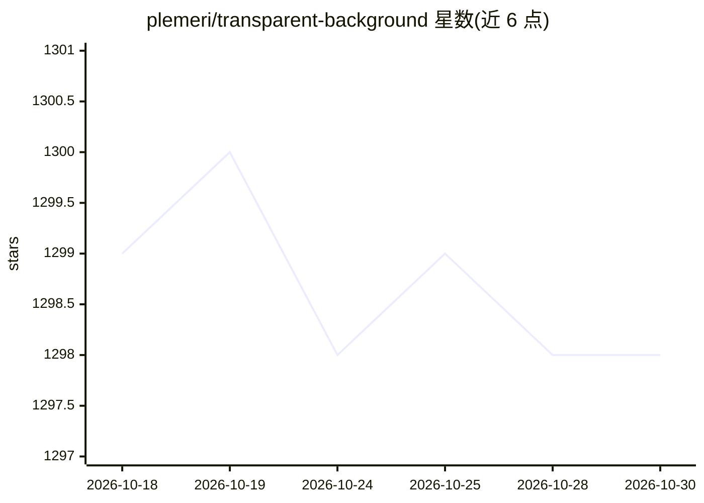

# plemeri/transparent-background

⭐ 1,298 · Python · MIT · 推送 2026-07-08 · [GitHub](https://github.com/plemeri/transparent-background) · 个人维护

**基于 InSPyReNet 的图片/视频/摄像头抠图去背景工具**

以 InSPyReNet（ACCV 2022 论文）为模型的二分图像分割工具，从图像、视频文件夹或摄像头输入中分离前景并生成透明背景。提供 CLI（transparent-background）、GUI（flet 可选）与 Python API 三种使用方式，输出类型包括 RGBA、显著性图、绿幕、白底、模糊、覆盖高亮及自定义背景图；支持 base/fast 模式、static/dynamic resize、TorchScript、阈值硬/软预测与结果反转。默认 checkpoint 自动从 Google Drive 下载，可用配置文件自定义下载地址与代理；webcam 输入仅稳定支持 Linux。

## 筛选速览

| 维度 | 判定 | 备注 |
|---|---|---|
| AI 角色 | `ai-native` | 本体是模型或模型工具 |
| 许可风险 | `permissive` | MIT |
| 部署形态 | `library` | 以包/库形式分发 |
| 模型依赖 | — | README 未给出锁定关系 |
| 硬件要求 | — | 无带数字的原话,不猜 |
| 安装摩擦 | `high` | 编译与系统依赖俱全 |
| 成熟度 | — | 结构信号不足 |

## 能力要点

- 支持单图/文件夹/视频/摄像头多种输入源
- 多种输出类型：RGBA、绿幕、白底、任意颜色、模糊、显著性图、换背景
- 提供 CLI、GUI、Python API 三种使用方式与外部 YAML 配置（自定义 checkpoint 与代理）
- 支持 base/fast/base-nightly 模式与自定义训练的 InSPyReNet checkpoint

## 适用场景

- 批量去除商品或人物照片背景生成透明 PNG
- 给视频更换绿幕或模糊背景
- Linux 上经虚拟摄像头实时去除会议画面背景
- 用自训练 InSPyReNet checkpoint 跑自定义分割

## 场景标签

`图像视频处理` · 领域:感知与多模态

## 证据(README 行号)

> L11: This is a background removing tool powered by InSPyReNet (ACCV 2022). You can easily remove background from the ima
> L196: * `--type [TYPE]` (optional): Choose between `rgba`, `map` `green`, `blur`, `overlay`, and another image file. Def

## 星数曲线

2026-10-18 1,299 → 2026-10-30 1,298（-1）

---
*卡片 v1 · prompt 1.4 · 生成 2026-10-21 · 置信度 high · 依据 README sha `54f986d7796f` · [字段定义](../../DATASET.md)*
