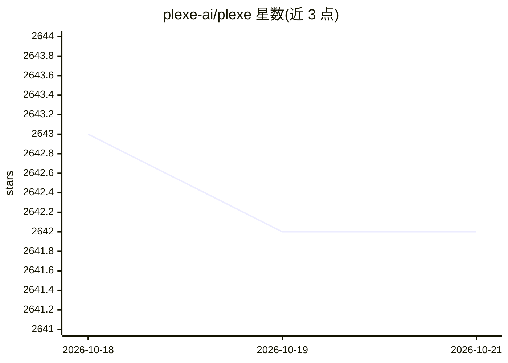

# plexe-ai/plexe

⭐ 2,642 · Python · Apache-2.0 · 推送 2026-03-06 · [GitHub](https://github.com/plexe-ai/plexe) · [官网](https://plexe.ai) · 组织维护

**用自然语言描述+数据集自动构建表格 ML 模型的多智能体系统**

Plexe 让用户以自然语言描述建模意图并提供表格数据集（Parquet/CSV/ORC/Avro），由 14 个专职 AI agent 组成的 6 阶段工作流完成数据/任务分析、评估指标选择、假设驱动的模型搜索、评估与部署打包。支持 XGBoost、CatBoost、LightGBM、Keras、PyTorch；LLM 经 LiteLLM 接入，官方测试仅覆盖 openai/* 与 anthropic/*。产出的模型包不依赖 plexe 本身，可独立部署；提供 Docker 镜像（含 PySpark/Java）、YAML 配置、Streamlit 实验面板，另有托管云服务。需 Python 3.10-3.12 与 LLM API key。

## 筛选速览

| 维度 | 判定 | 备注 |
|---|---|---|
| AI 角色 | `ai-native` | 本体是模型或模型工具 |
| 许可风险 | `permissive` | Apache-2.0 |
| 部署形态 | `self-host` | docker 或自建部署 |
| 模型依赖 | local-ok | 支持本地模型 |
| 硬件要求 | — | 无带数字的原话,不猜 |
| 安装摩擦 | `low` | 无编译、无系统依赖或容器化 |
| 成熟度 | — | 结构信号不足 |

## 能力要点

- 14 个专职 agent 组成 6 阶段自动化建模工作流
- 输出自包含模型包（不依赖 plexe，含推理代码）
- 经 LiteLLM 支持多提供商，可按 agent 分别路由不同 LLM
- 提供含 PySpark/Java 的 Docker 镜像与 Databricks Connect 镜像

## 适用场景

- 用一句话意图+数据集自动训练表格预测模型
- 自动完成指标选择、模型搜索与评估报告
- 把训练好的模型打包后部署到任意环境

## 场景标签

`多智能体` · 领域:Agent 开发

## 证据(README 行号)

> L15: **plexe** lets you create machine learning models by describing them in plain language. Simply explain what you wan
> L16: provide a dataset, and the AI-powered system builds a fully functional model through an automated agentic approach.
> L52: The system uses 14 specialized AI agents across a 6-phase workflow to:

## 星数曲线

2026-10-18 2,643 → 2026-10-21 2,642（-1）

---
*卡片 v1 · prompt 1.4 · 生成 2026-10-21 · 置信度 high · 依据 README sha `7a28c4e2ed09` · [字段定义](../../DATASET.md)*
