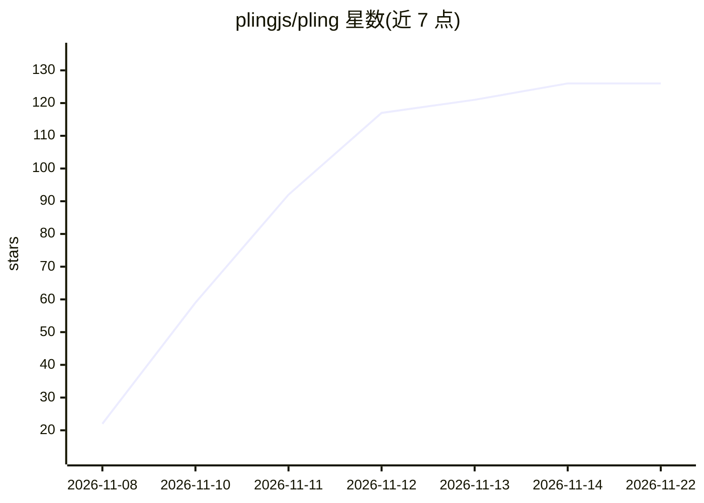

# plingjs/pling

⭐ 126 · TypeScript · Apache-2.0 · 推送 2026-11-16 · [GitHub](https://github.com/plingjs/pling) · [官网](https://plingjs.dev) · 组织维护 · 中文 README

**让网页向 AI agent 声明可控能力边界的开放能力层**

Pling 是面向 Web 应用的开放能力层：页面声明 agent 可检查与执行的操作，agent 通过与人类相同的控件和业务逻辑执行，校验、授权、状态与最终裁决权保留在应用侧。提供 14 个框架包（核心注册表、DOM 原语、agent 循环、Surface 协议、Vue/React/Vanilla 适配器、Node 网关等），并定义 pling.surface/0.1 外部 agent 契约与 MCP 支持。明确声明不是浏览器 agent、后端 API 替代或通用点击层。当前版本 0.1.0-alpha.9，API 与协议可能变化；开发需克隆后 pnpm build，入门示例使用确定性脚本化模型、无需 provider key。

## 筛选速览

| 维度 | 判定 | 备注 |
|---|---|---|
| AI 角色 | `ai-ecosystem` | LLM/agent 周边工具 |
| 许可风险 | `permissive` | Apache-2.0 |
| 部署形态 | `library` | 以包/库形式分发 |
| 模型依赖 | — | README 未给出锁定关系 |
| 硬件要求 | — | 无带数字的原话,不猜 |
| 安装摩擦 | `low` | 无编译、无系统依赖或容器化 |
| 成熟度 | `idea` | |

## 能力要点

- 页面显式声明 agent 可用的操作、记录、区域与只读状态
- agent 与人共用同一 handler、校验与确认门槛
- pling.surface/0.1 协议定义 describe/invoke 受控外部访问
- 14 个包覆盖核心、agent 循环、Surface 网关与 Vue/React/Vanilla 适配

## 适用场景

- 为自己的 Web 应用构建带确认与审计边界的 AI 助手
- 让外部 agent 通过受控协议访问页面能力而非猜测选择器
- 跨设备任务连续性与委托访问管理

## 场景标签

`Agent 框架` · 领域:Agent 开发

## 证据(README 行号)

> L5: Pling is an open capability layer for web applications. A page declares what an
> L37: |`@plingjs/agent`|Agent loop, context assembly, confirmation, continuity, and telemetry|

## 星数曲线

2026-11-08 22 → 2026-11-22 126（+104）

---
*卡片 v1 · prompt 1.4 · 生成 2026-11-17 · 置信度 mid · 依据 README sha `3de6772423c5` · [字段定义](../../DATASET.md)*
