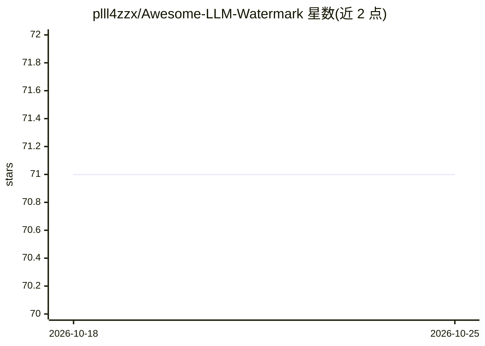

# plll4zzx/Awesome-LLM-Watermark

⭐ 71 · 推送 2026-03-30 · [GitHub](https://github.com/plll4zzx/Awesome-LLM-Watermark) · 个人维护

**LLM 水印论文清单：覆盖水印、攻击与检测研究**

面向研究者的 LLM 水印（LLM Watermark）论文聚合清单，自称保持更新。按 token 级、句子级、模型级、多模态、低熵、COT 水印等类别收录水印方案论文；另设攻击章节（窃取/移除/伪造攻击）、多比特水印、无偏水印、分析、扩散语言模型水印与综述章节。条目多为论文标题加会议出处（ICML/ICLR/ACL/NeurIPS/USENIX Security 等）与 arXiv/OpenReview/ACL Anthology 链接。不提供代码、安装或运行方式，仅作文献导航。

## 筛选速览

| 维度 | 判定 | 备注 |
|---|---|---|
| AI 角色 | `ai-knowledge` | 知识聚合/清单类 |
| 许可风险 | `none` | — |
| 部署形态 | `None` |  |
| 模型依赖 | — | README 未给出锁定关系 |
| 硬件要求 | — | 无带数字的原话,不猜 |
| 安装摩擦 | `low` | 无编译、无系统依赖或容器化 |
| 成熟度 | — | 结构信号不足 |

## 能力要点

- 按 8 类水印方案组织（token/句子/模型/多模态/COT/低熵等）
- 收录窃取、移除、伪造三类水印攻击研究
- 含多比特、无偏水印、扩散语言模型水印与综述章节
- 条目附会议出处与 arXiv/OpenReview/ACL Anthology 链接

## 适用场景

- 查找 LLM 水印方向的最新论文
- 调研水印攻击与鲁棒性研究进展
- 为水印相关研究撰写综述时收集文献

## 场景标签

`科研工具` `精选清单` · 领域:学习与行业

## 证据(README 行号)

> L6: An UP-TO-DATE collection list for Large Language Model (LLM) Watermark
> L10: * 1. LLM watermark

## 星数曲线

2026-10-18 71 → 2026-10-25 71（+0）

---
*卡片 v1 · prompt 1.4 · 生成 2026-10-24 · 置信度 high · 依据 README sha `b7467a6025f4` · [字段定义](../../DATASET.md)*
