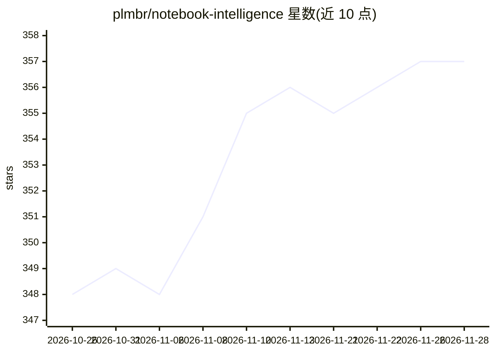

# plmbr/notebook-intelligence

⭐ 357 · Python · GPL-3.0 · 推送 2026-11-14 · [GitHub](https://github.com/plmbr/notebook-intelligence) · [官网](https://nbi.plmbr.dev) · 个人维护

**为 JupyterLab 提供多模型 AI 编程助手与可扩展 agent 框架**

JupyterLab 扩展（NBI），为笔记本添加聊天、内联编辑、自动补全和可驱动笔记本的 agent。内置四种 provider 适配器（GitHub Copilot、OpenAI 兼容、LiteLLM 兼容、Ollama），Anthropic Claude 通过 Claude Code CLI 的专用 Claude 模式接入。提供 MCP 外部工具调用、规则注入（ruleset）、技能（SKILL.md）与插件机制，以及 Default/Accept Edits/Plan/Bypass 四种权限模式和管理员策略门控。需 Python 3.10+、JupyterLab 4.x，Claude 模式与 MCP 另需 Node.js；LLM 费用由用户直接支付给 provider。

## 筛选速览

| 维度 | 判定 | 备注 |
|---|---|---|
| AI 角色 | `ai-native` | 本体是模型或模型工具 |
| 许可风险 | `viral` | GPL-3.0 |
| 部署形态 | `library` | 以包/库形式分发 |
| 模型依赖 | local-ok | 支持本地模型 |
| 硬件要求 | — | 无带数字的原话,不猜 |
| 安装摩擦 | `low` | 无编译、无系统依赖或容器化 |
| 成熟度 | — | 结构信号不足 |

## 能力要点

- 内置 GitHub Copilot、OpenAI 兼容、LiteLLM 兼容、Ollama 四种 provider 适配器
- Claude 模式将 Claude Code CLI 的工具、技能、MCP 服务器接入 JupyterLab 聊天面板
- MCP 外部工具调用、ruleset 规则注入与 SKILL.md 技能机制
- 四种权限模式加管理员策略门控，Bypass 默认关闭且不跨会话保留

## 适用场景

- 在 JupyterLab 中通过聊天面板与内联补全辅助编写笔记本代码
- 用本地 Ollama 模型在不向外部发送数据的环境下获得补全
- 让 agent 通过 MCP 调用外部工具读写文件、运行脚本
- 按工作区注入编码规范 ruleset 约束 agent 行为

## 场景标签

`Agent 框架` `AI 助手` `编码 Agent` · 领域:Agent 开发

## 证据(README 行号)

> L3: Notebook Intelligence (NBI) is an AI coding assistant and extensible AI framework for JupyterLab. It adds chat, inli
> L36: - **LLM Provider** — the service that runs the model. NBI ships with four provider adapters: GitHub Copilot, OpenAI
> L40: - **MCP** — Model Context Protocol. A way for the LLM to call out to external tools (read files, hit APIs, run scri

## 星数曲线

2026-10-26 348 → 2026-11-28 357（+9）

---
*卡片 v1 · prompt 1.4 · 生成 2026-11-25 · 置信度 high · 依据 README sha `53b11e74b76d` · [字段定义](../../DATASET.md)*
