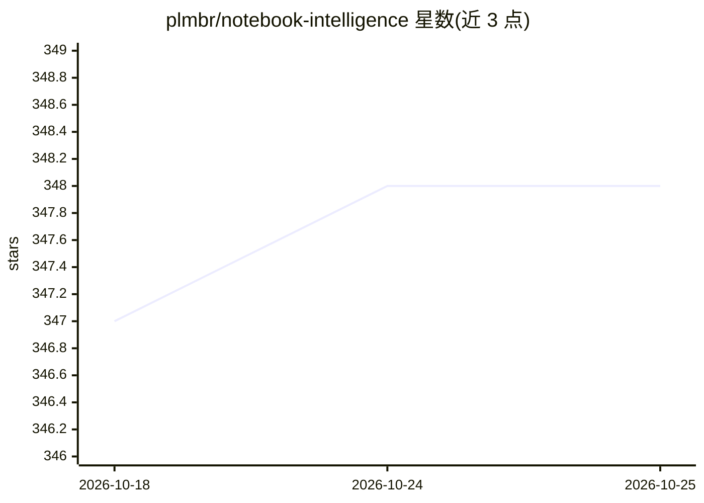

# plmbr/notebook-intelligence

⭐ 348 · Python · GPL-3.0 · 推送 2026-10-24 · [GitHub](https://github.com/plmbr/notebook-intelligence) · [官网](https://nbi.plmbr.dev) · 组织维护

**JupyterLab 的 AI 编码助手扩展与可扩展 AI 框架**

面向 JupyterLab 4.x 用户的 AI 编码助手扩展（labextension）：提供聊天面板、行内编辑、自动补全与可驱动笔记本运行的 agent。内置四种 LLM Provider 适配器：GitHub Copilot、OpenAI 兼容、LiteLLM 兼容与本地 Ollama；Anthropic Claude 通过 Claude 模式接入（Claude Code CLI 承担聊天面板，Anthropic API 承担行内补全）。支持 MCP 外部工具调用、规则注入、Claude 技能与插件，并提供权限模式（含默认关闭且需管理员策略启用的 Bypass Permissions）、会话恢复与用量统计。pip 安装，Claude 模式等部分功能需要 Node.js。

## 筛选速览

| 维度 | 判定 | 备注 |
|---|---|---|
| AI 角色 | `ai-ecosystem` | LLM/agent 周边工具 |
| 许可风险 | `viral` | GPL-3.0 |
| 部署形态 | `library` | 以包/库形式分发 |
| 模型依赖 | local-ok | 支持本地模型 |
| 硬件要求 | — | 无带数字的原话,不猜 |
| 安装摩擦 | `low` | 无编译、无系统依赖或容器化 |
| 成熟度 | — | 结构信号不足 |

## 能力要点

- 四种 Provider 适配器：Copilot / OpenAI 兼容 / LiteLLM 兼容 / Ollama
- Claude 模式将 Claude Code 的工具、技能、MCP 与自定义命令带入 JupyterLab
- 四级权限模式与服务器端策略钳制（Bypass 默认关闭且受管理员策略管控）
- MCP 外部工具调用、rules 规则注入、会话恢复与 token/成本用量页脚

## 适用场景

- 在 JupyterLab 内直接使用 LLM 聊天、行内编辑与自动补全
- 让 agent 驱动笔记本：编写单元格、运行 cell 等操作
- 通过本地 Ollama 模型在 notebook 环境中获得无外部 API 的辅助
- 在 JupyterLab 中使用 Claude Code 的工具与技能生态

## 场景标签

`编码 Agent` `代码生成` · 领域:编码与开发

## 证据(README 行号)

> L3: Notebook Intelligence (NBI) is an AI coding assistant and extensible AI framework for JupyterLab. It adds chat, inli
> L36: - **LLM Provider** — the service that runs the model. NBI ships with four provider adapters: GitHub Copilot, OpenAI

## 星数曲线

2026-10-18 347 → 2026-10-25 348（+1）

---
*卡片 v1 · prompt 1.4 · 生成 2026-10-21 · 置信度 high · 依据 README sha `533d2bc0bca1` · [字段定义](../../DATASET.md)*
