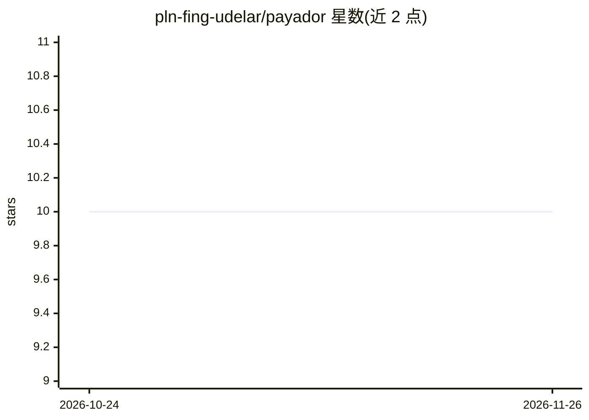

# pln-fing-udelar/payador

⭐ 10 · Python · GPL-3.0 · 推送 2026-08-19 · [GitHub](https://github.com/pln-fing-udelar/payador) · 组织维护

**为互动叙事与 RPG 研究提供基于 LLM 的世界状态更新系统**

PAYADOR 是 ICCC'24 论文提出的方法实现，针对互动叙事中的世界更新问题：将大语言模型接地到结构化世界数据（物品、角色、地点）上，预测玩家输入导致的世界状态变换，并生成叙事文本。系统通过 Gradio 网页界面运行，世界场景以 JSON 预配置（支持英语/西班牙语），叙事与推理可分别配置不同的 LLM 模型，默认使用 Gemini API；另附可选的 Flask 世界管理工具与论文引用信息，定位为可适配到其他互动叙事研究问题的研究代码。

## 筛选速览

| 维度 | 判定 | 备注 |
|---|---|---|
| AI 角色 | `ai-native` | 本体是模型或模型工具 |
| 许可风险 | `viral` | GPL-3.0 |
| 部署形态 | `None` |  |
| 模型依赖 | — | README 未给出锁定关系 |
| 硬件要求 | — | 无带数字的原话,不猜 |
| 安装摩擦 | `low` | 无编译、无系统依赖或容器化 |
| 成熟度 | — | 结构信号不足 |

## 能力要点

- 将 LLM 接地到结构化数据预测世界状态变换（世界更新问题）
- Gradio 网页界面，可游玩并查看调试面板
- 预配置世界场景以 JSON 提供，支持英语与西班牙语
- 叙事模型与推理模型可在 config.ini 中分别指定

## 适用场景

- 复现 ICCC'24 论文的互动叙事实验
- 为角色扮演游戏原型测试 LLM 驱动的世界状态更新
- 基于预配置世界进行即兴叙事互动游玩

## 场景标签

`科研工具` · 领域:学习与行业

## 证据(README 行号)

> L4: TL;DR: The PAYADOR approach to the world-update problem in Interactive Storytelling consists of grounding Large Lang
> L12: **`app.py`** — Run this to start the PAYADOR system. It launches an interactive Gradio web interface where you can 
> L72: The default implementation uses the Gemini API. Get your API key and store it in a `.env` file (in the project root

## 星数曲线

2026-10-24 10 → 2026-11-26 10（+0）

---
*卡片 v1 · prompt 1.4 · 生成 2026-11-19 · 置信度 high · 依据 README sha `67819a73490d` · [字段定义](../../DATASET.md)*
