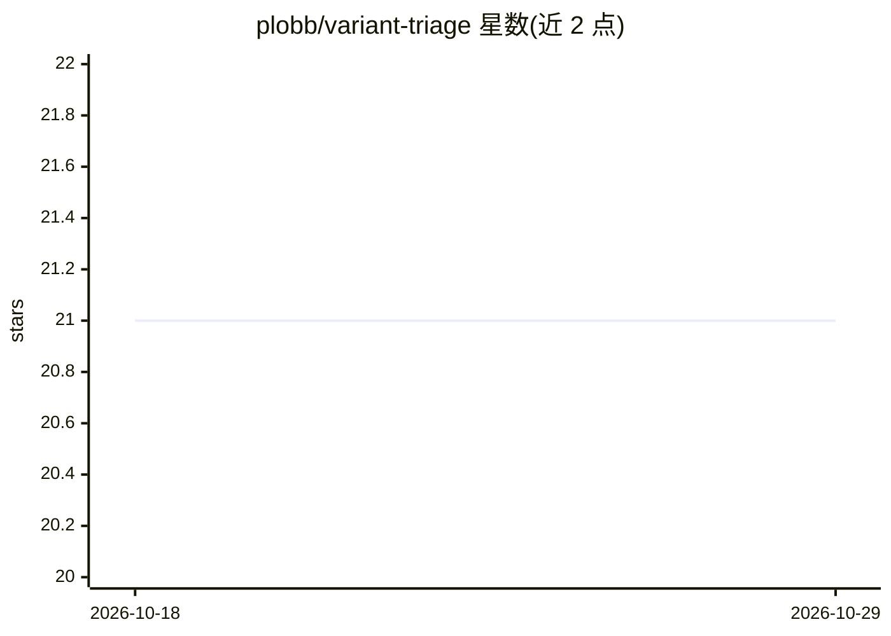

# plobb/variant-triage

⭐ 21 · Python · 推送 2026-04-28 · [GitHub](https://github.com/plobb/variant-triage) · 个人维护

**面向临床基因组学的变异分类解读后端服务（合成数据作品集项目）**

以 API 优先（FastAPI + PostgreSQL）的变异分诊后端：读取 VCF，经 ACMG/AMP 2015 种系规则（10 条规则插件化）与 AMP/ASCO/CAP 体细胞分级做确定性分类，整合 gnomAD GraphQL 与 ClinVar 证据客户端，并提供带护栏（正则校验、拒绝诊断/治疗建议输出）的 Claude 辅助解读草稿。强调可复现与可审计：170+ 测试、JWT 认证、SHA-256 审计日志、Nextflow DSL2 流程。声明为仅使用合成数据的作品集项目、仅供研究。提供 Docker Compose 部署与 Fly.io 在线演示。

## 筛选速览

| 维度 | 判定 | 备注 |
|---|---|---|
| AI 角色 | `ai-native` | 本体是模型或模型工具 |
| 许可风险 | `none` | — |
| 部署形态 | `self-host` | docker 或自建部署 |
| 模型依赖 | locked-api |  |
| 硬件要求 | — | 无带数字的原话,不猜 |
| 安装摩擦 | `low` | 无编译、无系统依赖或容器化 |
| 成熟度 | — | 结构信号不足 |

## 能力要点

- ACMG/AMP 种系 10 条规则插件化引擎与 AMP/ASCO/CAP 体细胞分级
- gnomAD GraphQL 与 ClinVar 证据客户端并发查询并内存缓存
- LLM 解读带护栏：正则校验阻止诊断与治疗建议输出，缺 token 时降级为 no-op
- 170+ 测试、JWT 认证、SHA-256 审计日志与容器化 CI/CD

## 适用场景

- 临床/转化基因组学团队以 REST API 方式做变异分类与证据整合
- 演示确定性分类逻辑与受限 LLM 辅助解读结合的系统设计
- 作为 Nextflow 流程（bcftools 归一化 + VEP 注释）与服务化 API 的衔接参考

## 场景标签

`科研工具` · 领域:学习与行业

## 证据(README 行号)

> L5: A backend service for **deterministic, evidence-grounded variant classification and interpretation**.
> L7: Unlike typical LLM-driven tools that generate plausible outputs, this system constrains reasoning through structured
> L127: |**6 - LLM assistant**|Claude-powered interpretation drafts with clinical guardrails|✅ Complete|

## 星数曲线

2026-10-18 21 → 2026-10-29 21（+0）

---
*卡片 v1 · prompt 1.4 · 生成 2026-10-28 · 置信度 high · 依据 README sha `1c48cecb6396` · [字段定义](../../DATASET.md)*
