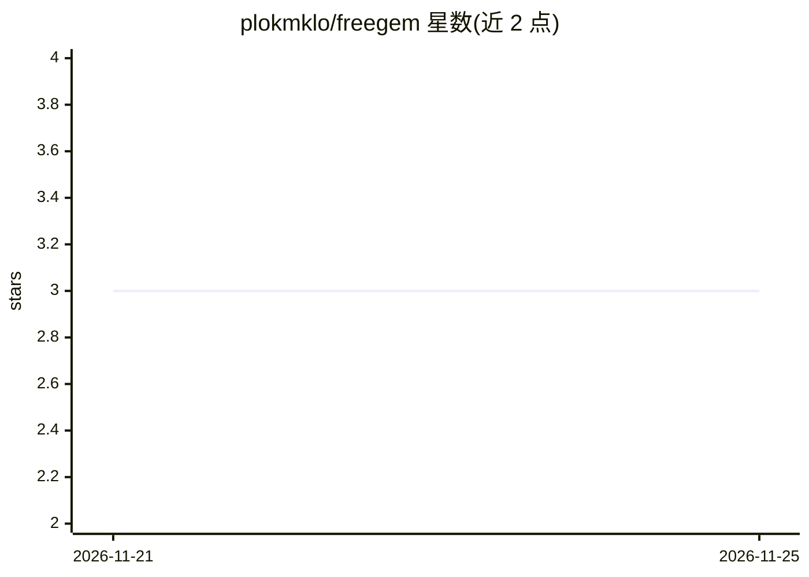

# plokmklo/freegem

⭐ 3 · Python · NOASSERTION · 推送 2026-11-22 · [GitHub](https://github.com/plokmklo/freegem) · [官网](https://github.com/plokmklo/freegem) · 个人维护

**本地桥接 Gemini Web 会话，暴露 OpenAI 兼容 API、Google 原生 API 与 MCP 工具**

将浏览器已登录的 Gemini Web 会话封装为本地桥，转换成三种标准接口：OpenAI 兼容与 Google 原生 HTTP API、MCP 工具服务器、一次性 CLI，客户端仅需改 base URL 即可接入，不使用 Gemini API key。附带受防护的网页工具层：抓取、多来源检索（带引用）、声明核验、有界可续爬虫，内置 SSRF 防护、响应上限与不可信内容隔离标记。服务器仅监听 loopback；embedings 端点返回 501 并说明原因；采样参数被接受但忽略。需 Python 3.10+，pip 从 Git 安装。

## 筛选速览

| 维度 | 判定 | 备注 |
|---|---|---|
| AI 角色 | `ai-ecosystem` | LLM/agent 周边工具 |
| 许可风险 | `none` | NOASSERTION |
| 部署形态 | `self-host` | docker 或自建部署 |
| 模型依赖 | — | README 未给出锁定关系 |
| 硬件要求 | — | 无带数字的原话,不猜 |
| 安装摩擦 | `low` | 无编译、无系统依赖或容器化 |
| 成熟度 | — | 结构信号不足 |

## 能力要点

- OpenAI 兼容 + Google 原生双协议 HTTP API 与 MCP 工具服务器
- 受防护的网页工具层：抓取、引用式研究、声明核验、有界爬虫，带 SSRF 防护
- 不可信网页内容用 [UNTRUSTED WEB CONTENT] 标记隔离，失败路径如实报告
- 1,183 项离线测试套件，CI 无需凭据与网络

## 适用场景

- 让已支持 OpenAI 协议的客户端（Cherry Studio、ChatBox、Open WebUI 等）接入 Gemini Web 会话
- 给 Claude Code、Cursor、Cline 等 agent 提供零配额的网页抓取与检索工具
- 用 CLI 做带引用的多来源研究与声明核验
- 本地批量读取网页与磁盘文件生成 JSONL 输出

## 场景标签

`模型网关` `网页抓取` · 领域:Agent 开发

## 证据(README 行号)

> L8: **A local bridge for Gemini Web, presented through the interfaces you already use.**
> L10: FreeGem wraps the Gemini Web session your browser already has and re-exposes it
> L12: API, an MCP tool server for agents, and a one-shot CLI. Existing tools connect

## 星数曲线

2026-11-21 3 → 2026-11-25 3（+0）

---
*卡片 v1 · prompt 1.4 · 生成 2026-11-21 · 置信度 mid · 依据 README sha `8586a4d0e600` · [字段定义](../../DATASET.md)*
