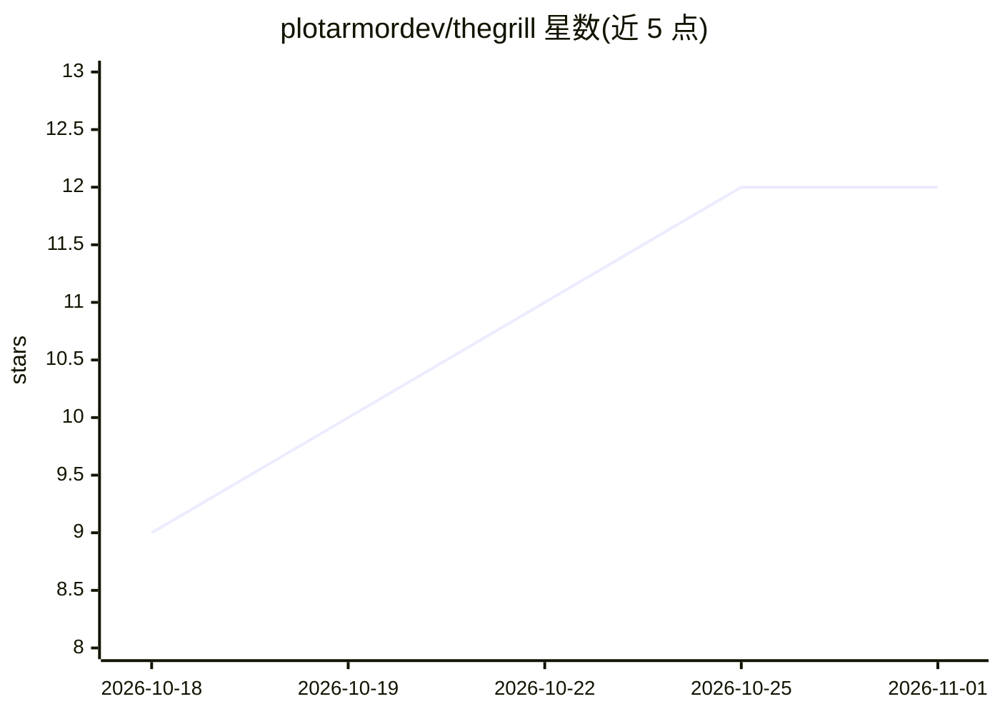

# plotarmordev/thegrill

⭐ 12 · Rust · Apache-2.0 · 推送 2026-10-21 · [GitHub](https://github.com/plotarmordev/thegrill) · 组织维护

**测量你的改动是否让 LLM 服务器变快的基准测试 CLI**

运行在本机、连接已有模型服务器的两类工具：grill-perf 做速度基准测试，对两次运行给出明确的 faster / slower / inconclusive / invalid 判定并保存证据；grill 做答案质量评估（标注 Work in progress），将错误、拒绝、截断、缺失结果分开统计，0.10.0 版本增加工具调用有效性检查。兼容任何上报流式 token 用量的 OpenAI 兼容服务器，已用于 vLLM、TensorFold、oMLX，支持 Linux 与 Apple Silicon。自述为早期实验性软件；质量 CLI 需从源码构建且不含在性能发布包中。

## 筛选速览

| 维度 | 判定 | 备注 |
|---|---|---|
| AI 角色 | `ai-ecosystem` | LLM/agent 周边工具 |
| 许可风险 | `permissive` | Apache-2.0 |
| 部署形态 | `None` |  |
| 模型依赖 | — | README 未给出锁定关系 |
| 硬件要求 | — | 无带数字的原话,不猜 |
| 安装摩擦 | `low` | 无编译、无系统依赖或容器化 |
| 成熟度 | `idea` | |

## 能力要点

- 两次运行对比输出 faster/slower/inconclusive/invalid 四种判定
- 兼容任何上报流式 token 用量的 OpenAI 兼容服务器
- 质量评估区分错误、拒绝、截断、缺失并检查工具调用有效性
- 附带解码/预填、长提示、多请求、对话历史等多种测试

## 适用场景

- 改动引擎、参数或机器后验证推理服务是否变快
- 比较同一模型在不同硬件配置上的表现
- 检查模型回答任务规则与工具调用的有效性

## 场景标签

`模型评测` · 领域:评测与运维

## 证据(README 行号)

> L5: **Did your change make your LLM server faster? The Grill measures it and tells you.**
> L16: Both tools run on your machine and connect to a server you already run. No account,
> L17: nothing uploaded. Works with any OpenAI-compatible server that reports token usage

## 星数曲线

2026-10-18 9 → 2026-11-01 12（+3）

---
*卡片 v1 · prompt 1.4 · 生成 2026-11-01 · 置信度 high · 依据 README sha `e6a7fb46765c` · [字段定义](../../DATASET.md)*
