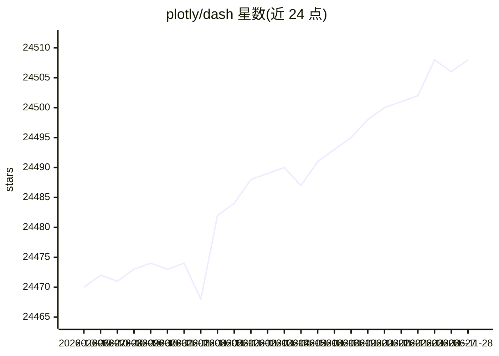

# plotly/dash

⭐ 24,508 · Python · MIT · 推送 2026-11-27 · [GitHub](https://github.com/plotly/dash) · [官网](https://plotly.com/dash) · 组织维护

**纯 Python 构建数据应用与仪表盘的 Web 框架**

基于 Plotly.js、React 和 Flask 的 Python 框架，将下拉框、滑块、图表等 UI 元素与 Python 分析代码绑定，无需编写 JavaScript 即可构建 ML 与数据科学 Web 应用；支持约 50 种图表类型，应用代码为声明式响应式写法。开源版在本地运行，另设 Dash Enterprise 提供部署、Kubernetes 扩缩、认证、任务队列与企业级模板等付费功能。

## 筛选速览

| 维度 | 判定 | 备注 |
|---|---|---|
| AI 角色 | `ai-enhanced` | 去掉 AI 部分产品仍成立 |
| 许可风险 | `permissive` | MIT |
| 部署形态 | `library` | 以包/库形式分发 |
| 模型依赖 | — | README 未给出锁定关系 |
| 硬件要求 | — | 无带数字的原话,不猜 |
| 安装摩擦 | `low` | 无编译、无系统依赖或容器化 |
| 成熟度 | — | 结构信号不足 |

## 动量与使用信号

- 维护:`active` — 距上次 push 2.5 天,年发版 21,197 位贡献者
- 涨星:近 1 天 **+1**(自 20261016 起算)

## 能力要点

- 无需 JavaScript，用 Python 绑定 UI 元素与分析代码
- 支持约 50 种图表类型（含地图），声明式响应式编程模型
- 提供 App Gallery 与入门教程，应用可嵌入现有网站
- 企业版提供水平扩展托管、多种 SSO 认证与 Job Queue

## 适用场景

- 为数据科学/ML 项目构建交互式仪表盘
- 生成风格化的财务或 PDF 样式报告页面
- 通过交叉筛选联动多输入多输出的分析看板

## 场景标签

 · 领域:数据可视化/应用开发框架

## 证据(README 行号)

> L9: #### *Dash is the most downloaded, trusted Python framework for building ML & data science web apps*.
> L11: Built on top of Plotly.js, React and Flask, Dash ties modern UI elements like dropdowns, sliders, and graphs direct
> L34: With Dash Open Source, Dash apps run on your local laptop or workstation, but cannot be easily accessed by others i

## 星数曲线

2026-10-26 24,470 → 2026-11-28 24,508（+38）

---
*卡片 v1 · prompt 1.4 · 生成 2026-11-22 · 置信度 mid · 依据 README sha `565630415623` · [字段定义](../../DATASET.md)*
