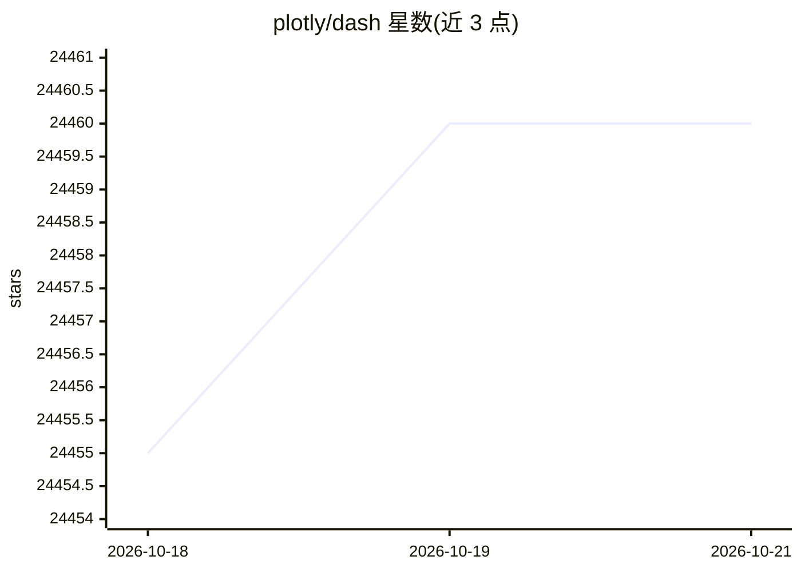

# plotly/dash

⭐ 24,460 · Python · MIT · 推送 2026-10-19 · [GitHub](https://github.com/plotly/dash) · [官网](https://plotly.com/dash) · 组织维护

**用纯 Python 构建数据应用与仪表盘的 Web 框架**

基于 Plotly.js、React 与 Flask 的 Python 框架，将下拉框、滑块、图表等 UI 元素直接绑定到分析代码，声明式响应式编写交互应用，无需写 JavaScript。README 给出下拉联动图表、交叉筛选、Mapbox 地图、PDF 风格财务报告等示例。开源版在本地运行；另提供 Dash Enterprise 商业版，含部署、Kubernetes 扩缩、认证、任务队列、低代码组件与 GPU/Dask 加速等功能。

## 筛选速览

| 维度 | 判定 | 备注 |
|---|---|---|
| AI 角色 | `ai-ecosystem` | LLM/agent 周边工具 |
| 许可风险 | `dual` | MIT |
| 部署形态 | `library` | 以包/库形式分发 |
| 模型依赖 | — | README 未给出锁定关系 |
| 硬件要求 | — | 无带数字的原话,不猜 |
| 安装摩擦 | `low` | 无编译、无系统依赖或容器化 |
| 成熟度 | — | 结构信号不足 |

## 动量与使用信号

- 维护:`active` — 距上次 push 2.5 天,年发版 21,197 位贡献者
- 涨星:近 1 天 **+1**(自 20261016 起算)

## 能力要点

- 纯 Python 编写交互式数据 Web 应用，无需 JavaScript
- 基于 Plotly.js，支持约 50 种图表类型（含地图）
- 声明式响应式代码模型，示例含交叉筛选应用
- 提供 Dash Enterprise 版本（部署/认证/任务队列/低代码组件）

## 适用场景

- 为机器学习与数据科学项目搭建交互式 Web 应用
- 构建可交叉筛选的数据仪表盘
- 生成报表风格的数据应用界面
- 企业内部署与扩展数据应用（Dash Enterprise）

## 场景标签

 · 领域:数据科学/可视化开发框架

## 证据(README 行号)

> L9: #### *Dash is the most downloaded, trusted Python framework for building ML & data science web apps*.
> L11: Built on top of Plotly.js, React and Flask, Dash ties modern UI elements like dropdowns, sliders, and graphs direct
> L32: ### Dash OSS & Dash Enterprise

## 星数曲线

2026-10-18 24,455 → 2026-10-21 24,460（+5）

---
*卡片 v1 · prompt 1.4 · 生成 2026-10-18 · 置信度 mid · 依据 README sha `64654f7c488c` · [字段定义](../../DATASET.md)*
