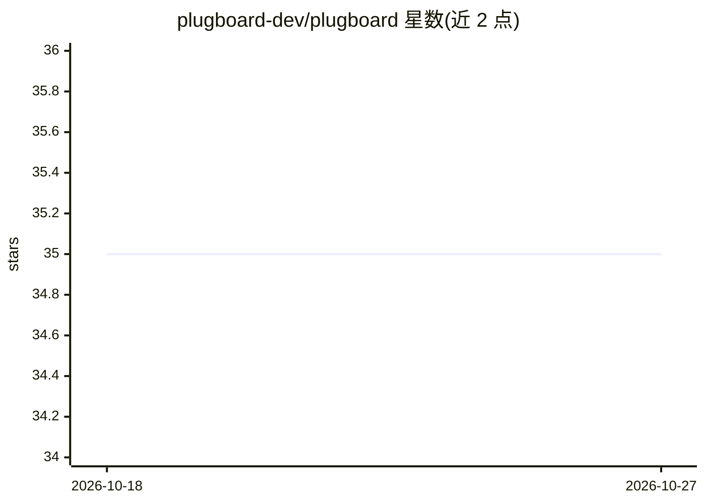

# plugboard-dev/plugboard

⭐ 35 · Python · Apache-2.0 · 推送 2026-10-25 · [GitHub](https://github.com/plugboard-dev/plugboard) · [官网](https://docs.plugboard.dev) · 组织维护

**Python 事件驱动建模与编排框架，用于仿真复杂互联过程**

Plugboard 是一个 Python 编写的事件驱动建模与编排框架，面向包含大量有状态互联组件的复杂过程仿真与驱动场景（如数字孪生、工业过程模拟）。用户以组件方式定义模型、声明输入输出并连线，框架自动处理组件间数据流动，支持离散时间与事件驱动两种仿真范式，同一模型可在本地、多处理器或云端集群（Ray 集成）运行。模型可用 YAML 规格保存并由 CLI 执行。内置 LLM 集成以构建 AI 增强的过程模型，支持多模型提供方切换。要求 Python >= 3.12，以 pip 安装。

## 筛选速览

| 维度 | 判定 | 备注 |
|---|---|---|
| AI 角色 | `ai-ecosystem` | LLM/agent 周边工具 |
| 许可风险 | `permissive` | Apache-2.0 |
| 部署形态 | `library` | 以包/库形式分发 |
| 模型依赖 | — | README 未给出锁定关系 |
| 硬件要求 | — | 无带数字的原话,不猜 |
| 安装摩擦 | `low` | 无编译、无系统依赖或容器化 |
| 成熟度 | — | 结构信号不足 |

## 能力要点

- 组件化建模，框架自动处理组件间数据流，支持离散时间与事件驱动仿真
- YAML 模型规格与 CLI 执行，同一模型可本地或云端运行
- Ray 集成支持多处理器与计算集群扩展
- 内置 LLM 组件集成，支持多提供方并可切换

## 适用场景

- 构建工业过程的数字孪生仿真模型
- 把物理仿真、机器学习与 AI 模型组合成统一过程模型
- 在 AI 编码助手中通过 AGENTS.md 上下文生成 Plugboard 模型代码

## 场景标签

 · 领域:工业仿真/数字孪生/过程建模

## 证据(README 行号)

> L25: Plugboard is an **event-driven modelling and orchestration framework** in Python for simulating and driving complex
> L47: - Built-in **LLM integrations** for building AI-augmented process models with support for multiple providers;

## 星数曲线

2026-10-18 35 → 2026-10-27 35（+0）

---
*卡片 v1 · prompt 1.4 · 生成 2026-10-25 · 置信度 high · 依据 README sha `be760c73575b` · [字段定义](../../DATASET.md)*
