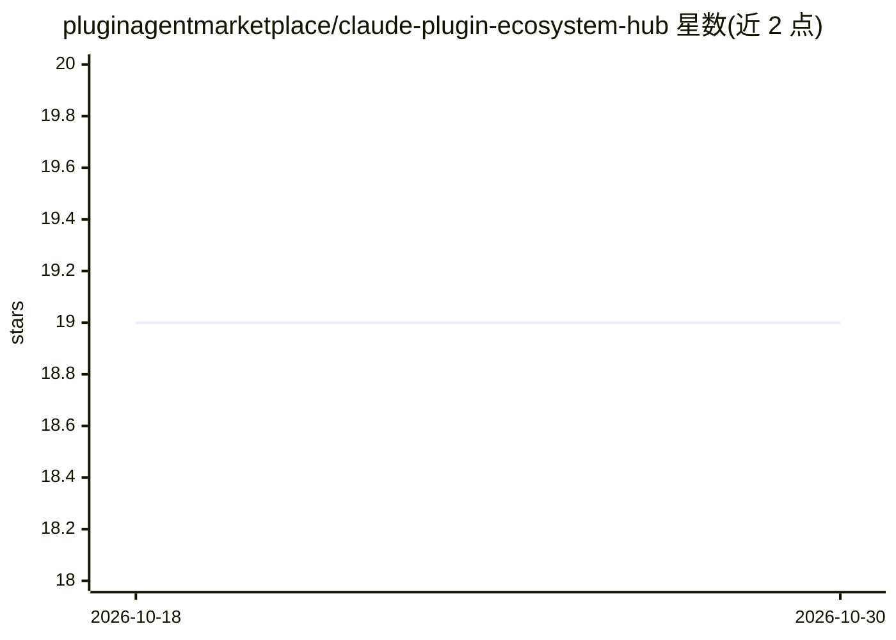

# pluginagentmarketplace/claude-plugin-ecosystem-hub

⭐ 19 · MIT · 推送 2025-12-31 · [GitHub](https://github.com/pluginagentmarketplace/claude-plugin-ecosystem-hub) · 组织维护

**Claude AI 扩展生态策展目录：插件/技能/MCP/市场索引**

面向开发者与企业的 Claude 生态资源目录：收录 10,000+ MCP 服务器与 500+ 插件，按插件市场、MCP 目录、Awesome 清单、专项集成（开发/数据库/云服务/生产力等 13 类）组织，标注数量与最后核验时间。提供 claude CLI 的插件与 MCP 安装命令参考、JSON 配置示例、技能发现路径说明及常见故障排查表。附第三方资源安全提示与月度更新元数据。条目为链接索引，非本仓库托管。

## 筛选速览

| 维度 | 判定 | 备注 |
|---|---|---|
| AI 角色 | `ai-knowledge` | 知识聚合/清单类 |
| 许可风险 | `permissive` | MIT |
| 部署形态 | `library` | 以包/库形式分发 |
| 模型依赖 | — | README 未给出锁定关系 |
| 硬件要求 | — | 无带数字的原话,不猜 |
| 安装摩擦 | `low` | 无编译、无系统依赖或容器化 |
| 成熟度 | — | 结构信号不足 |

## 能力要点

- 收录 10,000+ MCP 服务器与 500+ 插件的分类索引
- 6 个特色插件市场对比表与快速选型指南
- claude CLI 插件/MCP 安装命令与 JSON 配置示例
- 第三方资源安全提示与故障排查表

## 适用场景

- 为 Claude Code 查找插件、技能与 MCP 服务器
- 对比各插件市场的规模与功能后选型
- 按开发/数据库/云服务等类别查找 MCP 集成方案

## 场景标签

`精选清单` · 领域:学习与行业

## 证据(README 行号)

> L13: **A comprehensive, curated directory of Claude AI plugins, skills, MCP servers, commands, agents, and marketplaces.
> L25: Claude Code has revolutionized AI-assisted development through its extensible architecture. This repository serves 

## 星数曲线

2026-10-18 19 → 2026-10-30 19（+0）

---
*卡片 v1 · prompt 1.4 · 生成 2026-10-28 · 置信度 mid · 依据 README sha `58953727c142` · [字段定义](../../DATASET.md)*
