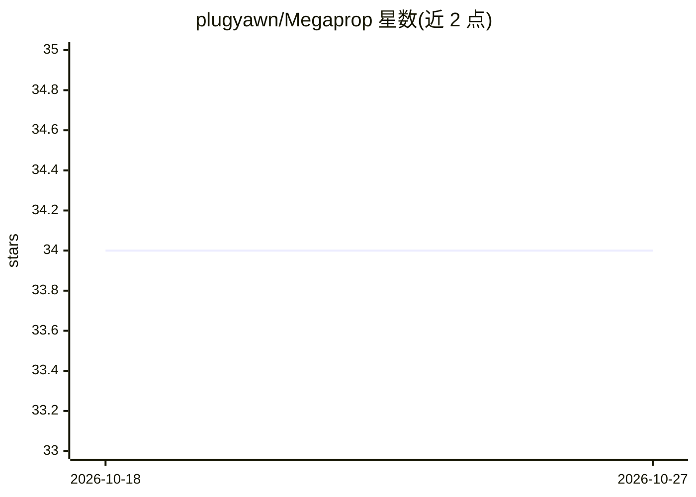

# plugyawn/Megaprop

⭐ 34 · 推送 2026-06-17 · [GitHub](https://github.com/plugyawn/Megaprop) · 个人维护

**面向 MoE 大模型训练的预条件优化器跨仓库集成工程**

以 superproject 形式固定三个 fork 分支（Megatron-LM、Emerging-Optimizers、TransformerEngine），实现 FOOF、KFAC、Locoprop-S、Newton-Muon 等右预条件优化器，通过在训练栈中路由 feature gram 矩阵（X^T X）避开激活流式传输，并内置 FSDP 与 MuP 支持。README 记录了 Megatron GPT / FineWeb Edu 上的 TP=2 扫描实验（Locoprop-S 对比 AdamW 的 wallclock 时间），附设计文档与各仓库改动 diff 统计。面向自建 LLM 训练流水线的开发/研究人员，需 git clone 递归子模块后自行组装运行。

## 筛选速览

| 维度 | 判定 | 备注 |
|---|---|---|
| AI 角色 | `ai-ecosystem` | LLM/agent 周边工具 |
| 许可风险 | `none` | — |
| 部署形态 | `None` |  |
| 模型依赖 | — | README 未给出锁定关系 |
| 硬件要求 | — | 无带数字的原话,不猜 |
| 安装摩擦 | `low` | 无编译、无系统依赖或容器化 |
| 成熟度 | — | 结构信号不足 |

## 能力要点

- Newton-Muon / Locoprop-S / FOOF / KFAC 预条件优化器实现
- 通过 TransformerEngine/Megatron-LM 改动路由 feature gram 矩阵，无需流式激活
- 开箱即用的 MuP 支持与 Muon 的 FSDP 支持
- superproject 固定子模块精确 SHA 以保证可复现

## 适用场景

- 在 Megatron-LM 训练栈中试验 Newton-Muon/Locoprop 类优化器
- 大规模 MoE/GPT 训练中对比预条件优化器与 AdamW 的收敛与速度
- 参考设计文档将 feature gram 机制上游到自有训练流水线

## 场景标签

`模型训练` · 领域:训练与推理

## 证据(README 行号)

> L2: Preconditioned Stochastic Gradient Descent primitives for FOOF, KFAC, Locoprop-S, and Newton-Muon with FSDP and out-
> L53: TL;DR: Cross-repo control repository for the FEATURE_GRAM matrix optimizer integration.

## 星数曲线

2026-10-18 34 → 2026-10-27 34（+0）

---
*卡片 v1 · prompt 1.4 · 生成 2026-10-25 · 置信度 mid · 依据 README sha `74a11d120eeb` · [字段定义](../../DATASET.md)*
