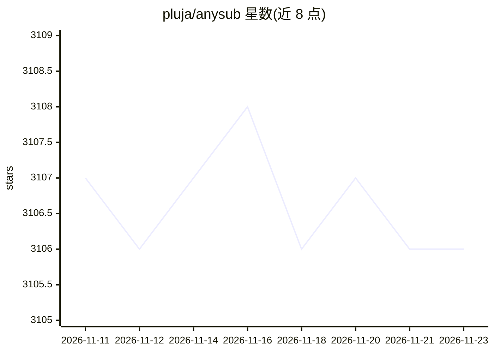

# pluja/anysub

⭐ 3,106 · TypeScript · AGPL-3.0 · 推送 2026-11-21 · [GitHub](https://github.com/pluja/anysub) · 个人维护

**自托管的音视频转字幕 Web 应用，本地运行 Whisper 转录**

Anysub（前身为 Whishper）将音频和视频转为字幕：上传录音后由 Whisper 转录，在带波形时间线的编辑器中修正文本与时间，再导出。支持从 tiny 到 large-v3-turbo 的模型、词级时间戳、过快/过长/重叠字幕警告、翻译、多种导出格式（SRT/WebVTT/LRC/纯文本/JSON）、可续传上传与可搜索的素材库。要求 Linux x86-64 上的 Docker 与 Docker Compose；GPU 转录需 NVIDIA 卡与 Container Toolkit，AMD/Intel GPU 尚不支持；也可仅通过外部服务商转录而无需本地模型。

## 筛选速览

| 维度 | 判定 | 备注 |
|---|---|---|
| AI 角色 | `ai-native` | 本体是模型或模型工具 |
| 许可风险 | `viral` | AGPL-3.0 |
| 部署形态 | `self-host` | docker 或自建部署 |
| 模型依赖 | — | README 未给出锁定关系 |
| 硬件要求 | — | 无带数字的原话,不猜 |
| 安装摩擦 | `low` | 无编译、无系统依赖或容器化 |
| 成熟度 | — | 结构信号不足 |

## 能力要点

- Whisper 转录，模型范围 tiny 到 large-v3-turbo，含词级时间戳
- 带波形时间线、撤销与自动保存的字幕编辑器
- 导出 SRT、WebVTT、LRC、纯文本或 JSON
- 可配置外部服务商（如 OpenAI、Groq）转录，无需本地 GPU

## 适用场景

- 在本机或自己的服务器上为录音和视频生成字幕
- 在网页编辑器中修正自动字幕的文本与时间轴
- 将字幕翻译为其他语言并导出多种格式

## 场景标签

`语音识别` · 领域:感知与多模态

## 证据(README 行号)

> L3: Anysub (formerly Whishper) makes subtitles from audio and video. Upload a recording, let Whisper transcribe it, then
> L9: - Transcription with Whisper, from the `tiny` model to `large-v3-turbo`.

## 星数曲线

2026-11-11 3,107 → 2026-11-23 3,106（-1）

---
*卡片 v1 · prompt 1.4 · 生成 2026-11-23 · 置信度 high · 依据 README sha `c731245864e5` · [字段定义](../../DATASET.md)*
