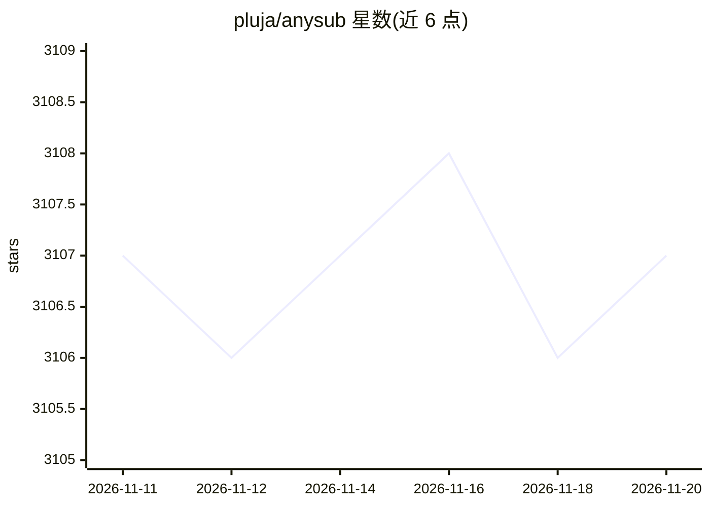

# pluja/anysub

⭐ 3,107 · TypeScript · AGPL-3.0 · 推送 2026-11-17 · [GitHub](https://github.com/pluja/anysub) · 个人维护

**本地自托管的字幕转写与编辑 Web 应用**

基于 Whisper 的字幕制作工具：上传音视频后由本地 Whisper（tiny 至 large-v3-turbo）转写，提供词级时间戳、带波形时间线的字幕编辑器（撤销/自动保存）、字幕速度与重叠警告，可导出 SRT/WebVTT/纯文本/JSON。全部运行在用户自己的电脑或服务器上，也可接入 OpenAI 或 Groq 等外部转写服务。安装要求 Linux x86-64 与 Docker Compose；NVIDIA GPU（GTX 16xx/RTX 20xx 及以上）可选加速，AMD/Intel GPU 暂不支持。翻译、说话人标签、多账户等功能尚未实现。前身为 Whishper，采用 AGPL-3.0-only 许可。

## 筛选速览

| 维度 | 判定 | 备注 |
|---|---|---|
| AI 角色 | `ai-native` | 本体是模型或模型工具 |
| 许可风险 | `viral` | AGPL-3.0 |
| 部署形态 | `self-host` | docker 或自建部署 |
| 模型依赖 | — | README 未给出锁定关系 |
| 硬件要求 | — | 无带数字的原话,不猜 |
| 安装摩擦 | `low` | 无编译、无系统依赖或容器化 |
| 成熟度 | `idea` | |

## 能力要点

- Whisper 本地转写，模型从 tiny 到 large-v3-turbo
- 带波形时间线的字幕编辑器，支持撤销与自动保存
- 导出 SRT、WebVTT、纯文本或 JSON
- 可选用外部转写服务（如 OpenAI、Groq）替代本地模型

## 适用场景

- 把自己的录音或视频转成字幕文件
- 在字幕编辑器里修正文字与时间轴后导出
- 在自有服务器上自托管转写服务，数据不出本机

## 场景标签

`语音识别` · 领域:感知与多模态

## 证据(README 行号)

> L3: Anysub (formerly Whishper) makes subtitles from audio and video. Upload a recording, let Whisper transcribe it, then
> L9: - Transcription with Whisper, from the `tiny` model to `large-v3-turbo`.

## 星数曲线

2026-11-11 3,107 → 2026-11-20 3,107（+0）

---
*卡片 v1 · prompt 1.4 · 生成 2026-11-17 · 置信度 mid · 依据 README sha `5c75c91d2225` · [字段定义](../../DATASET.md)*
