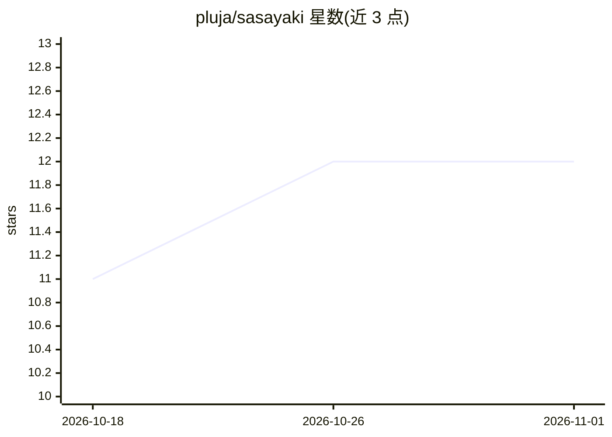

# pluja/sasayaki

⭐ 12 · Kotlin · 推送 2026-10-25 · [GitHub](https://github.com/pluja/sasayaki) · [官网](https://pluja.github.io/sasayaki/) · 个人维护

**安卓语音听写应用：连接自选后端把语音转成文字**

2MB 的 Android 听写应用，通过悬浮气泡或键盘麦克风键录音，发送到任意 OpenAI 兼容后端做语音转文字，可选再经 LLM 后处理将口语整理成书面文字（去填充词、纠正口误、按应用场景调整语气）。支持多后端、多配置档案、词汇表与替换规则；静音录音不上传，拒录密码框与银行支付应用。需 Android 9 及以上，通过 releases 页 APK 或 Obtainium 安装。作者声明本应用由 AI 辅助编写。

## 筛选速览

| 维度 | 判定 | 备注 |
|---|---|---|
| AI 角色 | `ai-native` | 本体是模型或模型工具 |
| 许可风险 | `none` | — |
| 部署形态 | `desktop` | 安装包/桌面程序 |
| 模型依赖 | — | README 未给出锁定关系 |
| 硬件要求 | — | 无带数字的原话,不猜 |
| 安装摩擦 | `low` | 无编译、无系统依赖或容器化 |
| 成熟度 | — | 结构信号不足 |

## 能力要点

- 连接任意 OpenAI 兼容后端做语音转文字，自托管无需 key
- 可选 LLM 后处理：按档案设置标点、大小写、改写幅度、语气与 emoji
- 隐私机制：静音录音丢弃、拒录密码框与银行/支付应用、无分析无云备份
- 悬浮气泡 + HeliBoard/FlorisBoard 键盘麦克风键两种触发方式

## 适用场景

- 在任意应用里用语音代替打字输入
- 连接自托管 whisper/LLM 后端实现私密听写
- 按应用（邮件/聊天）切换不同的听写语气与风格

## 场景标签

`语音识别` · 领域:感知与多模态

## 证据(README 行号)

> L7: A tiny (2MB) Android dictation app. Point it at any OpenAI-compatible backend and type by speaking.
> L25: - **Post-processing**: a small model turns what you said into a clean written message.

## 星数曲线

2026-10-18 11 → 2026-11-01 12（+1）

---
*卡片 v1 · prompt 1.4 · 生成 2026-11-01 · 置信度 high · 依据 README sha `c263234974bd` · [字段定义](../../DATASET.md)*
