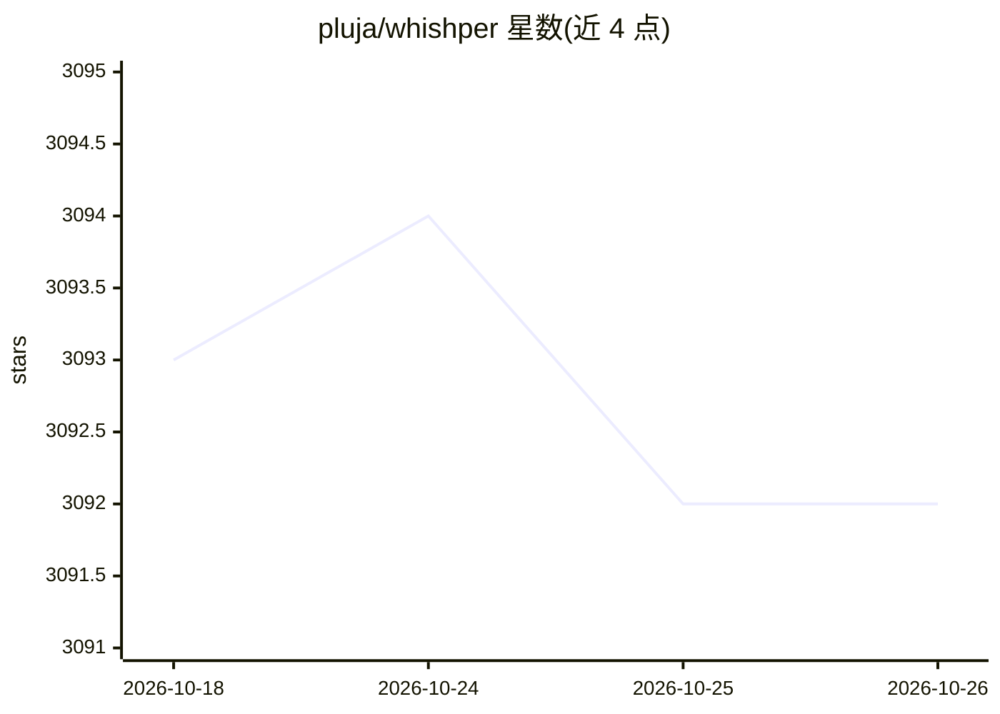

# pluja/whishper

⭐ 3,092 · Svelte · AGPL-3.0 · 推送 2026-07-31 · [GitHub](https://github.com/pluja/whishper) · [官网](https://whishper-docs.pages.dev/) · 个人维护

**本地音频转写与字幕编辑的 Web 套件**

开源、完全本地运行的音频转写与字幕制作套件，提供 Web UI。核心功能：转写任意媒体（音频/视频，支持从 URL 或上传文件），输出 TXT/JSON/VTT/SRT 等格式；通过 Libretranslate 容器翻译转写文本；内置字幕编辑器（基于媒体位置的高亮、CPS 警告、分段拆分/插入）。转写后端为 Faster-Whisper，支持 NVIDIA GPU 与 CPU，可离线运行。架构由 transcription-API、backend、frontend 加 Libretranslate、MongoDB、Nginx 组件构成。README 声明当前分支不再更新，重写版在 v4 分支进行。

## 筛选速览

| 维度 | 判定 | 备注 |
|---|---|---|
| AI 角色 | `ai-native` | 本体是模型或模型工具 |
| 许可风险 | `viral` | AGPL-3.0 |
| 部署形态 | `None` |  |
| 模型依赖 | — | README 未给出锁定关系 |
| 硬件要求 | — | 无带数字的原话,不猜 |
| 安装摩擦 | `low` | 无编译、无系统依赖或容器化 |
| 成熟度 | — | 结构信号不足 |

## 能力要点

- 以 Faster-Whisper 为后端转写，支持 GPU 与 CPU，可离线运行
- 转写结果导出为 TXT/JSON/VTT/SRT 或复制到剪贴板
- 集成字幕编辑器：媒体位置高亮、CPS 警告、分段拆分与插入
- 通过 Libretranslate 容器翻译转写文本

## 适用场景

- 上传或从 URL 拉取音视频，本地转写为文本或字幕
- 编辑与翻译字幕文件而不离开 Web UI
- 在无网络环境下本地完成转写与字幕工作

## 场景标签

`语音识别` · 领域:感知与多模态

## 证据(README 行号)

> L5: **Whishper** is an open-source, 100% local audio transcription and subtitling suite with a full-featured web UI.
> L21: - [x] 🚀 **Fast**: uses FasterWhisper as the Whisper backend: get much faster transcription times on CPU!

## 星数曲线

2026-10-18 3,093 → 2026-10-26 3,092（-1）

---
*卡片 v1 · prompt 1.4 · 生成 2026-10-20 · 置信度 high · 依据 README sha `a68f4e2bff2f` · [字段定义](../../DATASET.md)*
