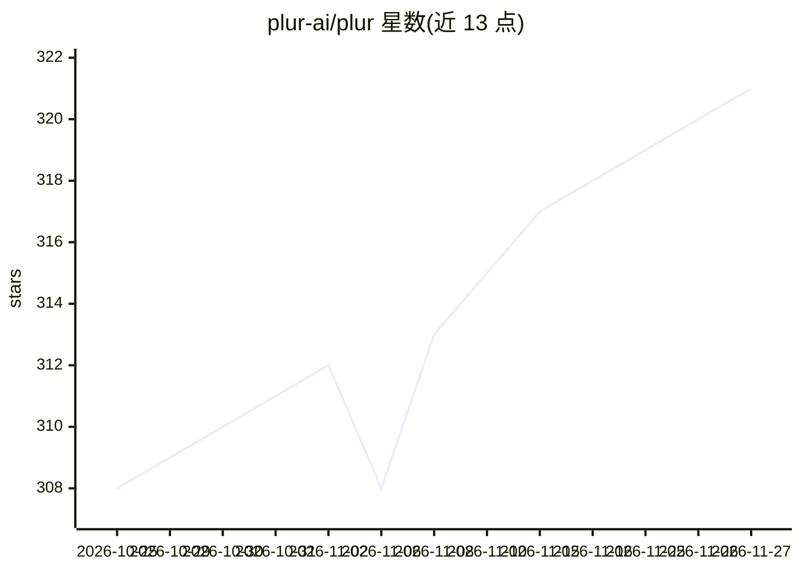

# plur-ai/plur

⭐ 321 · TypeScript · Apache-2.0 · 推送 2026-11-24 · [GitHub](https://github.com/plur-ai/plur) · [官网](https://plur.ai) · 组织维护

**给 AI agent 提供本地共享记忆的 MCP 记忆层**

PLUR 为 AI agent 提供跨会话、跨工具、跨机器的持久化共享记忆：以本地纯文本 engram（YAML）存储纠错、偏好与约定，用户可直接读取、更正、删除。通过 MCP server 与 hooks 适配 Claude Code、Codex、Cursor、OpenCode、OpenClaw 等客户端，实现记忆自动注入；检索采用 BM25+本地嵌入混合，可完全离线运行，无云端调用。以 npm CLI 分发，提供 plur init/doctor 配置与诊断，支持 domain/scope 知识隔离及远程团队存储。

## 筛选速览

| 维度 | 判定 | 备注 |
|---|---|---|
| AI 角色 | `ai-ecosystem` | LLM/agent 周边工具 |
| 许可风险 | `permissive` | Apache-2.0 |
| 部署形态 | `library` | 以包/库形式分发 |
| 模型依赖 | — | README 未给出锁定关系 |
| 硬件要求 | — | 无带数字的原话,不猜 |
| 安装摩擦 | `low` | 无编译、无系统依赖或容器化 |
| 成熟度 | — | 结构信号不足 |

## 能力要点

- 本地纯文本 engram 存储，可读、可更正、可删除
- 混合检索（BM25+本地嵌入），可完全离线、无需 API key
- 7 个客户端带 hooks 自动注入，其余 MCP 客户端可用工具
- domain/scope 按内容粒度的知识隔离与团队共享 scope

## 适用场景

- 让 Claude Code 与 Codex 等多个工具共享同一份偏好与纠错记忆
- 公司镜像/内网环境下本地运行 agent 记忆
- 团队知识按 scope 隔离，避免全局记忆串项目

## 场景标签

`Agent 记忆` · 领域:Agent 开发

## 证据(README 行号)

> L13: Persistent, **open** memory for AI agents — local-first, zero-cost, shared across MCP tools (Claude Code, Codex, Cu
> L56: ## Install
> L157: Every MCP client can call PLUR's tools. Only some have an *adapter* — the hooks

## 星数曲线

2026-10-25 308 → 2026-11-27 321（+13）

---
*卡片 v1 · prompt 1.4 · 生成 2026-11-25 · 置信度 mid · 依据 README sha `accf419e4971` · [字段定义](../../DATASET.md)*
