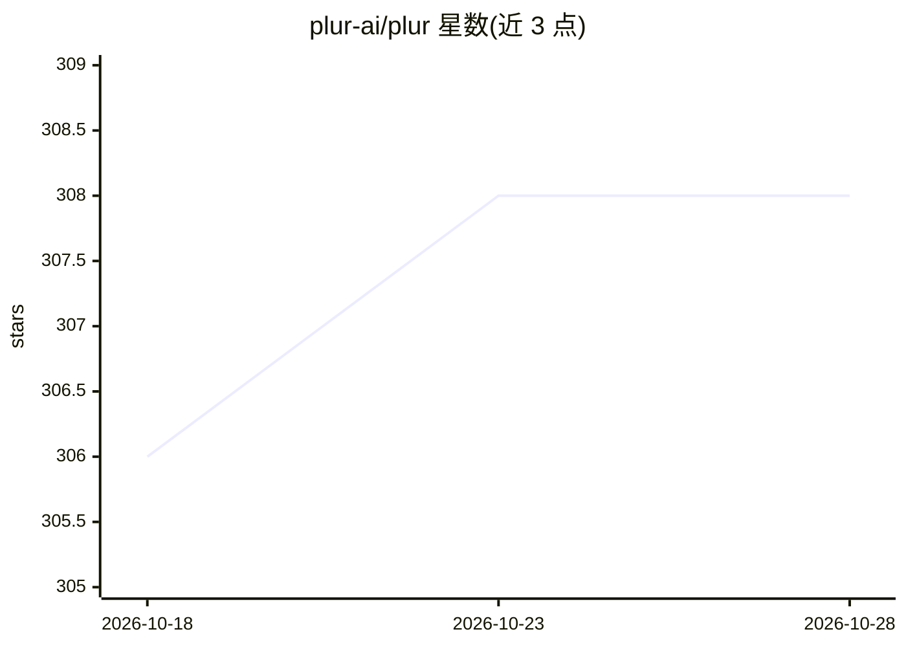

# plur-ai/plur

⭐ 309 · TypeScript · Apache-2.0 · 推送 2026-10-28 · [GitHub](https://github.com/plur-ai/plur) · [官网](https://plur.ai) · 组织维护

**面向 AI agent 的本地优先共享记忆层（MCP 记忆服务器）**

PLUR 是给 MCP 客户端（Claude Code、Codex、Cursor、OpenCode 等）提供持久共享记忆的本地优先 MCP 服务器与 CLI：agent 学到的纠正、偏好与约定以纯 YAML engram 存储在 ~/.plur/，跨会话、跨工具、跨机器共享。检索采用 BM25 + 本地嵌入的混合搜索，可选用本地重排器（BGE-reranker），无云端调用；对 Claude Code、Codex、Cursor、OpenCode 等提供 hooks 实现自动注入记忆。安装需要 Node.js 20+，通过 npm 全局安装后运行 plur init / plur doctor。Codex 需手动信任 hooks，部分客户端（Windsurf、Gemini CLI 等）仅有 tools-only 支持，无自动注入。

## 筛选速览

| 维度 | 判定 | 备注 |
|---|---|---|
| AI 角色 | `ai-ecosystem` | LLM/agent 周边工具 |
| 许可风险 | `permissive` | Apache-2.0 |
| 部署形态 | `library` | 以包/库形式分发 |
| 模型依赖 | — | README 未给出锁定关系 |
| 硬件要求 | — | 无带数字的原话,不猜 |
| 安装摩擦 | `low` | 无编译、无系统依赖或容器化 |
| 成熟度 | — | 结构信号不足 |

## 能力要点

- 记忆以纯 YAML engram 存储在本地磁盘，可读、可改、可删
- 本地混合检索（BM25 + 嵌入，可选 BGE 重排器），无需云端调用
- 为 Claude Code/Codex/Cursor/OpenCode/Antigravity 等提供 hooks 自动注入适配
- 支持按 domain/scope 区分项目、团队与全局知识

## 适用场景

- 在 Cursor 里教过的架构约定，希望 Claude Code 也能记得
- 让 agent 记住我对编码风格的纠正，跨会话持久生效
- 本地数据主权要求下为多个 MCP 工具共享一套记忆

## 场景标签

`Agent 记忆` · 领域:Agent 开发

## 证据(README 行号)

> L13: Persistent, **open** memory for AI agents — local-first, zero-cost, shared across MCP tools (Claude Code, Codex, Cu
> L58: Requires **Node.js 20 or newer**. Install both packages so editor configurations can use the installed MCP server:

## 星数曲线

2026-10-18 306 → 2026-10-28 308（+2）

---
*卡片 v1 · prompt 1.4 · 生成 2026-10-22 · 置信度 mid · 依据 README sha `19ba2c2aa41a` · [字段定义](../../DATASET.md)*
